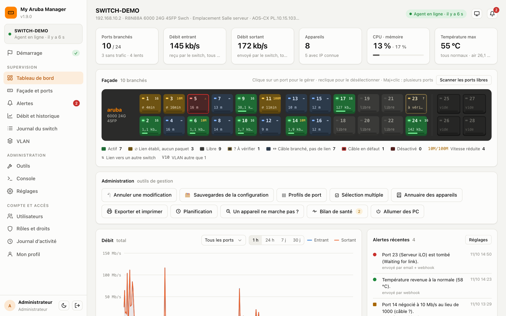
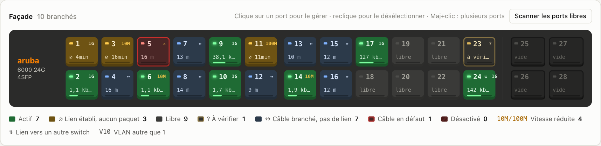
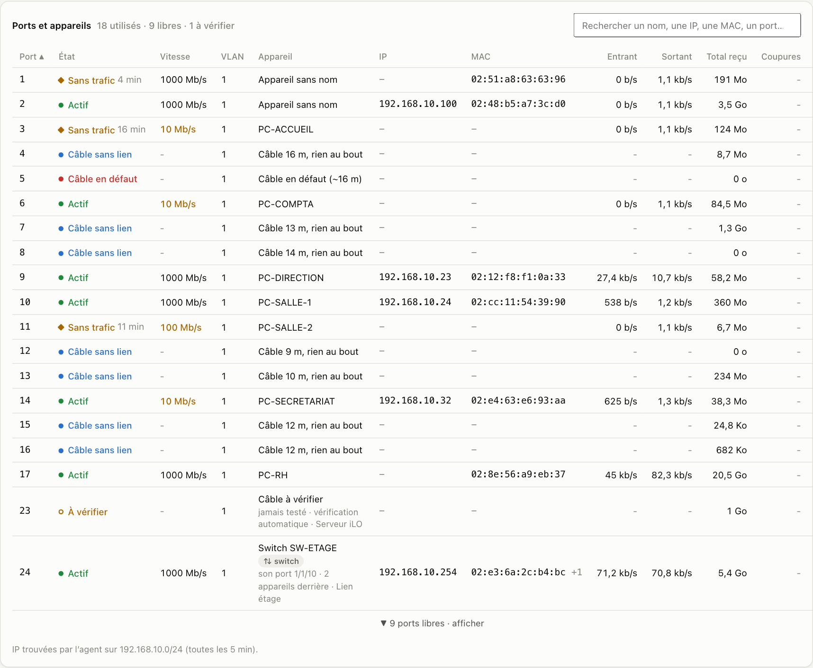
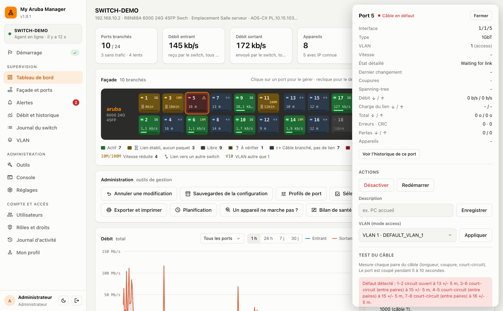
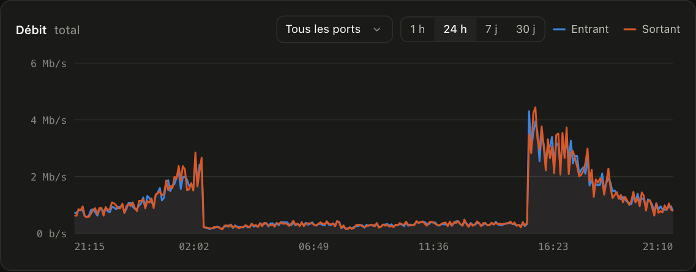
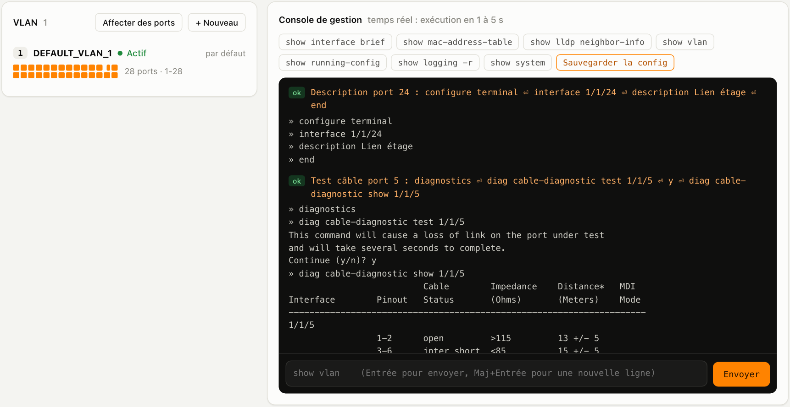
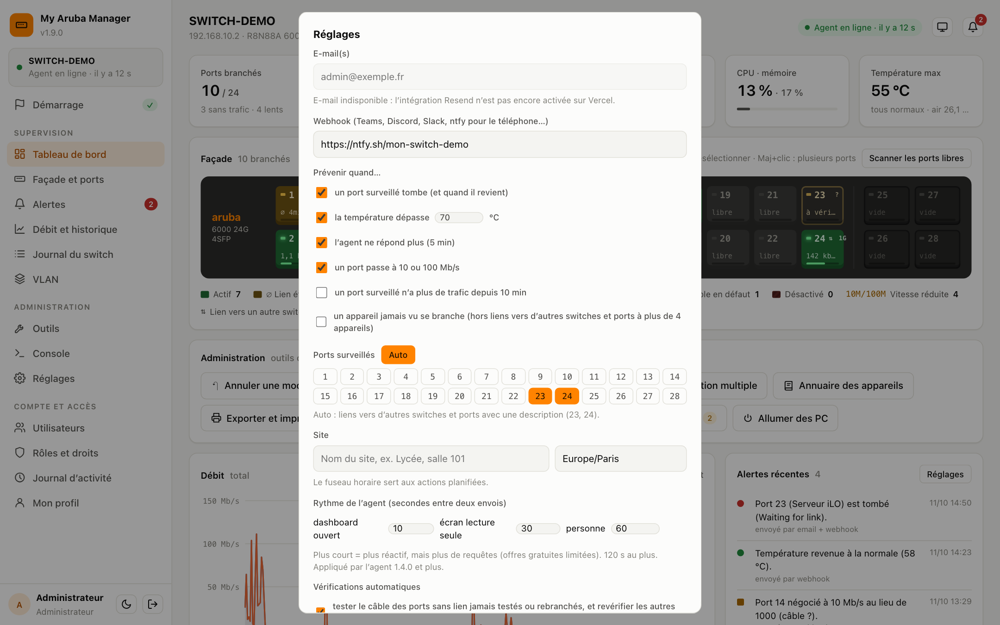
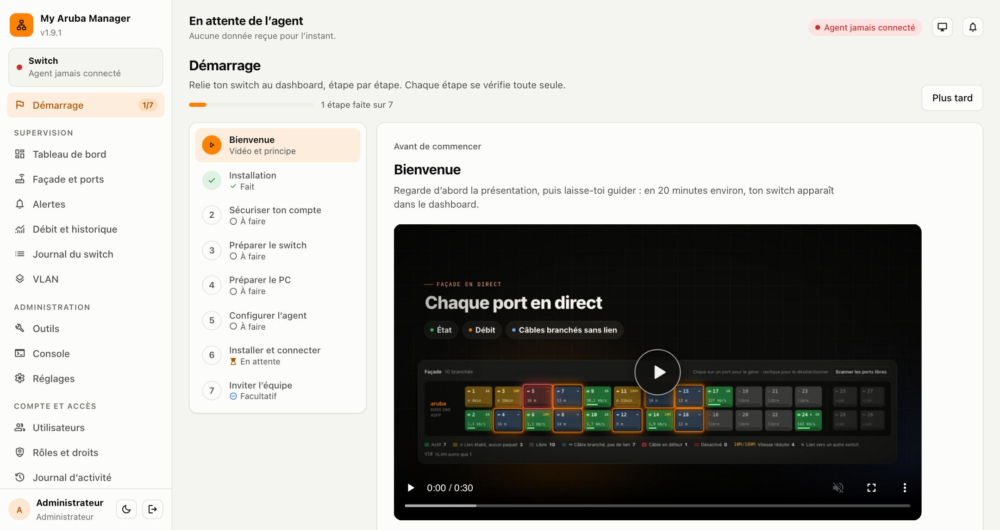
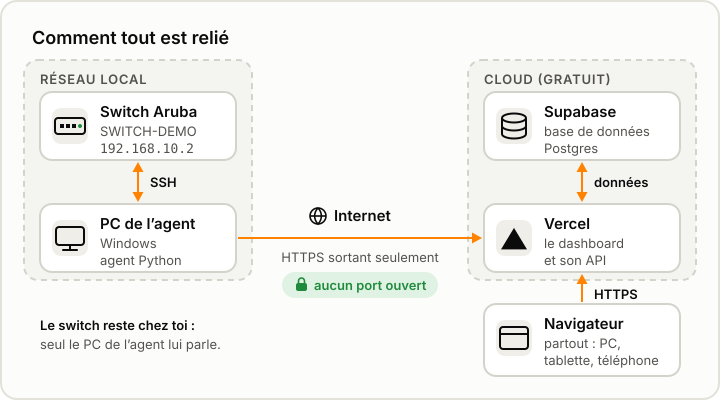

# My Aruba Manager

**Monitor and manage an HPE Aruba Networking CX switch from anywhere, in your browser, without opening a single port on your network.**

[](public/media/my-aruba-manager.mp4)

The animation above plays the 30-second presentation (no sound). **▶ [Download the MP4 video](public/media/my-aruba-manager.mp4)**
(7 MB: on the GitHub page that opens, click "View raw"). It also plays inside the dashboard, in the setup assistant.

A web dashboard for **HPE Aruba Networking CX** switches (AOS-CX): live front panel, throughput and history,
connected devices with their IP addresses, VLANs, cable tests, command console, alerts and administration tools.
Built for schools, networking courses (such as the French BTS SIO, BTS CIEL and IUT programs) and small organizations.
The user interface is in French.
It runs on the free plans of Vercel and Supabase and relies on a small Python agent installed on a PC of the local network.

[](https://github.com/ethanfrq/ArubaDashboardSwitch/releases/latest)
[](LICENSE)
[](#compatibility-and-limits)

**Version française : [README.fr.md](README.fr.md)**

> Created by **Ethan** ([@ethanfrq](https://github.com/ethanfrq)). Compatible with HPE Aruba Networking CX.
>
> Independent project, not affiliated with or endorsed by HPE.
> Aruba, HPE Aruba Networking and AOS-CX are trademarks of Hewlett Packard Enterprise.

> **Get started in 20 minutes**
>
> 1. Click the **Deploy** button below (deploy with Vercel) and paste the three requested values
>    ([how to create them](docs/GUIDE.en.md#1-deploy-on-vercel)): Vercel copies the project into your account
>    and adds the Supabase database to it.
> 2. Open your dashboard and log in with the identifier `admin`: the **setup assistant** guides you
>    until the switch is connected, checking each step live.
>
> Everything is explained with pictures in the **[step-by-step installation guide](docs/GUIDE.en.md)**.
>
> [](https://vercel.com/new/clone?repository-url=https%3A%2F%2Fgithub.com%2Fethanfrq%2FArubaDashboardSwitch&env=DASHBOARD_PASSWORD,SESSION_SECRET,AGENT_TOKEN&envDescription=Dashboard%20password%2C%20session%20key%20and%20agent%20token&envLink=https%3A%2F%2Fgithub.com%2Fethanfrq%2FArubaDashboardSwitch%2Fblob%2Fmain%2Fdocs%2FGUIDE.en.md%231-deploy-on-vercel&project-name=my-aruba-manager&repository-name=my-aruba-manager&stores=%5B%7B%22type%22%3A%22integration%22%2C%22integrationSlug%22%3A%22supabase%22%2C%22productSlug%22%3A%22supabase%22%7D%5D)

---

## Features

### Monitoring
- **Live front panel**: every port with its state, negotiated speed and throughput. Slow ports (10/100 Mb/s),
  links to other switches and ports that are "connected but without traffic" are highlighted.
- **Cables detected without a link**: a scan of the free ports shows whether a cable is plugged in, its length and whether it is faulty.
- **Verified "free" ports**: a port without a link is only shown as free when a recent cable test confirms it.
  Ports never tested, or plugged and unplugged since the last test, are marked "to be checked" and tested
  automatically in small batches; the others are checked again every 2 hours (can be turned off in the settings).
- **Throughput and history**: the last hour live, then 24 hours, 7 days and 30 days, in total or port by port.
- **Ports and devices**: a single table (name, IP, MAC, throughput, errors) with search and sorting.
- **Switch health**: CPU, memory, temperatures, uptime, IP, MAC, serial number, firmware.
- **Unsaved configuration** shown in the top bar, with one-click save.
- **Spanning tree**: root switch, blocked ports (network loop), abnormal broadcast traffic.
- **History of each port**: since when it has been up or down, number of link drops, unstable ports.
- **Switch log**: the latest events, translated into plain French (links, logins, spanning tree).
- **Frequent polling without overloading the switch**: link state and log every 30 s, spanning tree and
  saved configuration every 2 min; commands whose output rarely changes are spaced out, and everything slows down
  when the switch CPU rises.

### Management
- Enable, disable or restart a port, change its description.
- **VLANs**: create, rename, delete, assign ports.
- **Cable test** (TDR): length and state of each pair, with a plain-language verdict.
- **Console**: any CLI command; yes/no questions from the switch are shown as buttons.
- One-click configuration save.

### Administration without touching the code
Everything is set from the **Administration** card and the ⚙ settings:
- **Undo a change**: before each change, the dashboard creates a restore point on the switch.
  You see what will be undone, then roll back in one click (by typing CONFIRMER). For a sensitive change
  (management IP, link to another switch, and so on), the switch **rolls back on its own after 5 minutes** unless you confirm
  that everything still works: you cannot lock yourself out.
- **Configuration backups**: automatic copy after each change and every 6 hours, history,
  line-by-line comparison between two versions, download (secrets masked), return to a switch restore point.
- **Port profiles** (student PC, printer, Wi-Fi access point, server, unused port; all editable): VLAN, description,
  protections (BPDU guard, admin-edge, loop-protect) and state applied in one click.
- **Multiple selection**: Shift+click or Ctrl+click on ports (or the selection tool on mobile), then an action bar:
  enable, shut down, restart, VLAN, description with automatic numbering, profile, power on, test cables.
- **Device directory**: name a PC once and its name follows it on every port; port history,
  optional "new device" alert. **Patch plan** (wall socket, room, note) for each port,
  **CSV export** and **printing** of the plan.
- **Scheduled actions**: shut down, re-enable or restart ports, power on PCs at a set time, carried out
  even when the dashboard is closed (never while the agent is offline; 8 ports or more must be confirmed with CONFIRMER).
- **Power on PCs remotely** (Wake-on-LAN) and **ping** from the agent's PC.
- **Port diagnosis** (clear steps and a one-sentence conclusion) and a **"device not working?"** troubleshooting guide.
- **Health check**: unsaved configuration, protections on user ports, NTP, default SNMP community,
  unused ports, cables, slow or unstable ports, and more, with one-click fixes.
- **Settings**: site name, time zone, agent pace, alerts.
- **Sidebar** to move between the dashboard, the tools and the account pages, on a computer or a phone.

### User accounts and roles
One account per person, each with their own password, and every action signed in the **activity log**.
- **Administrator**: everything, including accounts.
- **Technician**: works on access ports (enable, shut down, restart, description, VLAN, cable test, Wake-on-LAN,
  ping, device names, patch plan). No console, no settings, no accounts, and never a link to another switch.
  The server checks every command line by line.
- **Read-only**: sees everything on display, changes nothing. Ideal for a wall screen (30-day session, refresh every 30 s).
- **Users** page: create an account with an **invitation link** (valid 48 h, the person chooses their password;
  sent by e-mail when Resend is set up) or with a password you choose; change the role, require two-factor
  authentication, send a new-password link, close sessions, disable or delete.
- **My profile**: name, e-mail, alerts by e-mail, password, **two-factor authentication** (6-digit code from an app
  such as Google Authenticator or Microsoft Authenticator, with single-use recovery codes), log out other devices, theme.
- **Monitoring view**: a button hides every command without logging out.

### Alerts
- By **e-mail** (Resend) and/or **webhook** (Teams, Slack, Discord, ntfy for your phone, and others).
- Monitored port going down or coming back, temperature too high, agent stopped, slow link, link without traffic,
  new device (optional), failed scheduled action.

### Comfort
- Light and dark mode, loading indicators and notifications for every action.
- Mandatory confirmation, showing the exact lines sent to the switch, before any change.
- **Check after each change**: the dashboard verifies in the next switch reading that the change
  was actually applied (port enabled or shut down, VLAN, description, VLAN created or deleted, configuration saved) and warns you otherwise.

### Getting started
- **Installation to finish**: as long as the database or a Vercel variable is missing, the login page says so
  (names only, never a value) with a short illustrated tutorial for each item and a "Revérifier" (check again) button.
- **Setup assistant**: on first launch, the administrator is guided step by step (video, installation,
  account security, switch, Windows PC, agent, team and alerts). Each step is checked live, and
  the agent shows up as soon as it connects for the first time.
- **Pre-filled `agent_config.json` file**: downloaded from the assistant (dashboard address and agent token
  already filled in), it only needs the switch IP.
- **Welcome window** for each new account: the video, what their role allows, and a shortcut to
  enable two-factor authentication.

---

## Screenshots

*All screenshots show the French interface with demo data (fictitious names, IP and MAC addresses).*

**Overview**: indicators, switch front panel, throughput and alerts, in light or dark mode.

<picture>
  <source media="(prefers-color-scheme: dark)" srcset="docs/captures/apercu-sombre.png">
  
</picture>

**Live front panel**: active ports (green), no traffic (amber), cable plugged in without a link (blue, with its length), faulty cable (red),
cable state to be checked (amber outline).



**Ports and devices**: a single table with name, IP, MAC, throughput and errors, with search and sorting.



**Port details**: information, actions (enable, restart, description, VLAN) and pair-by-pair cable test.



**History**: total or per-port throughput over 1 hour, 24 hours, 7 days or 30 days.



**VLANs and console**: each VLAN with its mini front panel, and a console that runs any switch command.



**Settings**: e-mail and/or webhook alerts, monitored ports, temperature threshold, automatic cable checks.



**Setup assistant**: the video, then each installation step checked live.



---

## How it works



<details>
<summary>Text version of the diagram</summary>

```
┌──────────┐   SSH    ┌───────────────────┐ HTTPS (outbound) ┌──────────────────┐
│  Switch  │ ◄──────► │  Python agent     │ ───────────────► │  Vercel          │ ◄── browser
│ Aruba CX │          │  (PC on the LAN)  │ ◄─────────────── │  page + API      │
└──────────┘          └───────────────────┘     commands     └─────────┬────────┘
                                                                       ▲
                                                                       │ data
                                                                       ▼
                                                          ┌─────────────────────────┐
                                                          │  Supabase (Postgres)    │
                                                          │  5-min job (pg_cron)    │
                                                          └─────────────────────────┘
```

</details>

The switch has a private address, so Vercel cannot reach it. An **agent** installed on a PC of the local network
reads the switch over SSH, sends its state to the dashboard and runs the requested commands.
**The agent always contacts Vercel, never the other way around**: no port to open on your network.

Vercel hosts the page and the API. The data (switch state, history, settings, command log,
configuration backups, device directory) is stored in a **Supabase** database (Postgres)
attached to the Vercel project. The tables are created automatically on first launch, and the check that runs
every 5 minutes (agent offline, scheduled actions, backups) is scheduled automatically
in Supabase with pg_cron. E-mail alerts go through Resend (optional).

To stay within the free plans, the agent sends the state every **60 s** when nobody is watching,
every **30 s** for a read-only screen and every **10 s** while the administrator dashboard is open. It then fetches
commands every **5 s** (**1.5 s** right after a command). The page reloads the state right after each upload from
the agent, and only reloads the command log, the alerts and the detailed reading when they have changed.

The agent **updates itself, only from published versions** (the
[Releases](https://github.com/ethanfrq/ArubaDashboardSwitch/releases) page of this repository): code that is still
in development is never installed. If an update fails, the previous version is restored automatically.

---

## Installation

Everything is explained step by step, with pictures, in the **[installation guide](docs/GUIDE.en.md)** (about 20 minutes).
In the dashboard, the **setup assistant** repeats the same steps and checks each one live.

### What you need
- An **HPE Aruba Networking CX** switch with a management IP, SSH enabled and its SSH account (often `admin`).
- A **PC that stays on** in the same network as the switch, with internet access.
  Windows is recommended: the agent installs there as a service, and the step-by-step guide is written for it.
  The agent also runs on macOS and Linux.
- A **GitHub** account and a **Vercel** account (free Hobby plan). The **Supabase** database (free plan)
  is added from Vercel. Nothing else to sign up for.

### In short
1. **Deploy on Vercel** with the button at the top of this page. Vercel asks for three variables:

   | Variable | Purpose | How to generate it |
   |---|---|---|
   | `DASHBOARD_PASSWORD` | password of the `admin` account | a strong, unique password |
   | `SESSION_SECRET` | key used to sign sessions | `openssl rand -base64 32` |
   | `AGENT_TOKEN` | token shared with the agent | `openssl rand -hex 32` |

   On Windows without `openssl`, the [guide](docs/GUIDE.en.md#1-deploy-on-vercel) gives the equivalent PowerShell command.
2. **Add Supabase**: the button offers to add it during the deployment (Free plan, Paris region).
   Otherwise: **Storage** tab of the Vercel project, **Create Database**, **Supabase**, then **redeploy** (**Deployments** tab,
   ⋯ menu of the latest deployment, **Redeploy**). On first launch, the dashboard creates its tables and schedules
   the 5-minute check in Supabase: there is no script to run.
3. **Log in** with the identifier **`admin`** and `DASHBOARD_PASSWORD`: the setup assistant opens.
4. **Secure the account** in **Mon profil** (my profile): your own password and **two-factor authentication**.
5. **Prepare the switch**: SSH enabled (`ssh server vrf default`, or `ssh server vrf mgmt` if the agent goes through
   the management port), management IP reachable from the agent's PC.
6. **Install the agent** on the Windows PC: Python 3, the `aruba-agent-x.y.z.zip` package from the
   [latest release](https://github.com/ethanfrq/ArubaDashboardSwitch/releases/latest), the `agent_config.json` file
   **downloaded pre-filled from the assistant**, then `installer-service.bat` as administrator.
   Details and manual method: [`agent/INSTALL-WINDOWS.md`](agent/INSTALL-WINDOWS.md)
   (in French: [`agent/INSTALLATION-WINDOWS.md`](agent/INSTALLATION-WINDOWS.md)).
7. **Invite your team and set up alerts** from **Utilisateurs** (users) and **Réglages** (settings).

**E-mail alerts (optional)**: add **Resend** from the Vercel Marketplace, then redeploy.
Without a verified domain, Resend only writes to the address of your own Resend account: to write to other addresses,
verify your domain in Resend, then set `ALERT_FROM` (e-mail sender, for example `Switch <alerts@my-domain.com>`)
to that domain. Other optional variable: `DASHBOARD_URL` (link included in the alerts).
Webhook alerts need no additional service.

`DASHBOARD_PASSWORD` stays valid for the `admin` account as a **backup password**: keep it long and secret.

Problem during installation, updating the dashboard: see the [Troubleshooting](docs/GUIDE.en.md#troubleshooting)
and [Updating](docs/GUIDE.en.md#updating) sections of the guide.

---

## Security

### What is in place
- One account per person, passwords stored hashed (scrypt, 10 characters minimum); signed session (`HttpOnly`,
  `Secure`, `SameSite=Strict` cookie); 15-minute lockout after 8 failed attempts.
- Disabling an account, changing its password or closing its sessions logs it out everywhere immediately.
- **Two-factor authentication** (TOTP) per account, with single-use recovery codes; an administrator can require it.
- **Activity log**: logins (and refused attempts), account changes, commands and settings, with who and when.
- The agent authenticates with `AGENT_TOKEN`. The switch SSH password **never leaves the agent's PC**:
  it is encrypted there by Windows (DPAPI).
- Roles are checked by the server on every request. Read-only: no command except automatic readings (checked line
  by line), no command history, no configuration diff details. Technician: only the port commands listed above,
  checked line by line, never on a link to another switch and never a sensitive command.
- Every change goes through a window that shows the exact lines sent to the switch.
- AOS-CX abbreviations ("int 1/1/24", "shu", and so on) are recognized: they cannot bypass the second confirmation.
  Tabs and control characters are refused; typed text (description, name) cannot add a command line.
- Automatic actions (schedules, cleanup, backups) never run a command considered sensitive.
- Dangerous commands (reboot, erase, accounts, management IP, links to other switches,
  port of the agent's PC, and so on) require a **second confirmation enforced by the server**:
  a single-use token valid for 2 minutes and typing the word CONFIRMER.
- **Hardened web page**: strict Content-Security-Policy (no inline scripts) and systematic escaping of data
  coming from the network (device names announced over LLDP or DNS, descriptions, switch log), so that crafted text
  cannot run in the page. The page cannot be displayed inside a frame on another site.
- The agent only updates from **published versions** (GitHub releases), never from work in progress.
- No secret is committed (`.env*`, `agent_config.json` and `agent_secret.bin` are excluded).
- Before login, the page only shows the **names** of missing variables, never their values.
- The pre-filled `agent_config.json` file contains the agent token: only an administrator can download it
  (required two-factor authentication is enforced), the response is never cached and the download is recorded
  in the activity log, without the token. The switch SSH password is never in it.
- Your data stays in your own Vercel and Supabase accounts: the author of the project has no access to it.

### Lost phone (two-factor authentication)
Use one of the recovery codes. If you have none left, another administrator resets it from **Utilisateurs**
(button **Gérer**). If you are the only administrator: open the database in Supabase (from Vercel: **Storage** tab,
your database, then **Open in Supabase**), go to the **Table Editor**, open the `mam_kv` table and delete the row
whose key is `mam:totp:owner`. Log in with `admin` and the password, then enable it again with your new phone.

### Forgotten password
An administrator sends a new-password link from **Utilisateurs**. For the `admin` account,
`DASHBOARD_PASSWORD` (Vercel settings) always works as a backup password.

### Recommendations
- Choose a **strong, unique** administrator password, different from the switch password.
- **Enable two-factor authentication** at the first login.
- Ideally, the management interface of network equipment should only be reachable **through a VPN**
  (WireGuard, Tailscale) rather than exposed publicly. In Vercel mode the page is, by design, reachable
  from the internet: the password and two-factor authentication are therefore essential. The local mode planned
  in the [roadmap](#roadmap) will allow access restricted to the local network or a VPN.
- Do not share the URL needlessly; give each person the smallest role that is enough, and a read-only account to a display screen.
- Download the important configuration backups regularly: the Supabase free plan
  does not back up the database automatically.

### Limits of the Vercel mode
- **Vercel's Hobby plan is limited to personal, non-commercial use.** A company or a paid service
  needs a paid Vercel plan (or can wait for the local mode planned in the roadmap).
- The free plans of Vercel and Supabase **do not come with a GDPR data processing agreement**.
  The dashboard stores IP and MAC addresses, device names and the action log, which may be
  personal data. **For a school or an organization, have this choice approved by the person in charge**
  (head of the school, IT manager, data protection officer) before going live.

---

## Compatibility and limits
- Tested on an **HPE Aruba Networking CX 6000 24G 4SFP** (AOS-CX 10.15). The front panel is designed for
  24-port + 4 SFP models. Other CX models may work but have not been tested.
- The switch is read through the CLI over SSH: parsing the output may depend on the firmware version.
- One switch per dashboard, one agent per switch.
- User interface in French only.
- Vercel free plan: at most 12 functions per deployment; the project is designed to stay within this limit.
- Supabase free plan:
  - 500 MB of database and 5 GB of outbound bandwidth per month;
  - the project is paused after 7 days without activity. The agent writes continuously, so this only happens
    if the agent's PC stays off for a week. The project can then be resumed from the Supabase dashboard;
  - no automatic database backup.

## Roadmap
Planned next steps, with no set date:
- **All-in-one local mode**: the agent becomes the server (page and API on the local PC), SQLite database,
  no cloud account, Docker image. Access from the local network or through a VPN.
- **Reading the switch through the AOS-CX REST API** instead of the CLI over SSH.
- **Several switches** in the same dashboard.

## Project structure
| Folder | Contents |
|---|---|
| `public/index.html` | the user interface (a single page, no framework) |
| `public/js/` | the administration features on the page side, one per file |
| `public/vendor/` | third-party library served with the page (QR code for two-factor authentication) |
| `public/media/` | presentation video and its poster |
| `public/onboarding/` | illustrations of the setup assistant and the guide |
| `api/` | Vercel functions (Node 24) |
| `lib/` | database (Supabase, Postgres), accounts, roles (administrator, technician, read-only), two-factor authentication, activity log, notifications, installation and setup assistant |
| `lib/features/` | the server side of the administration features |
| `agent/` | the Python agent, its automatic update and its installation as a Windows service |
| `docs/` | [installation guide](docs/GUIDE.en.md) (English and French) and screenshots |

---

## Author
Designed and developed by **Ethan** ([@ethanfrq](https://github.com/ethanfrq)).

## Contributing
[Issues](https://github.com/ethanfrq/ArubaDashboardSwitch/issues) and
[pull requests](https://github.com/ethanfrq/ArubaDashboardSwitch/pulls) are welcome: bugs, ideas,
questions, support for another CX switch model, and more.
- For a bug or another switch model, give the model, the AOS-CX version and the agent version.
  Remove IP and MAC addresses, names and secrets from what you share.
- For a significant change, please open an issue first to discuss it.
- By submitting a contribution, you agree that it is licensed under the Apache License 2.0 (section 5 of the license).

## Releases
What changed in each version is listed in [`CHANGELOG.md`](CHANGELOG.md) (in French) and on the [Releases](https://github.com/ethanfrq/ArubaDashboardSwitch/releases) page.

## License
My Aruba Manager is licensed under the **Apache License 2.0**: see [`LICENSE`](LICENSE).
You may use, modify and redistribute it, including commercially, provided that you include the license,
keep the copyright notices and the [`NOTICE`](NOTICE) file, and state which files you changed.
The license grants no rights to names or trademarks.

Third-party components (postgres, qrcode-generator, paramiko, and others) remain under their own licenses:
see [`THIRD-PARTY-NOTICES.md`](THIRD-PARTY-NOTICES.md).

## Trademarks
Aruba, HPE Aruba Networking and AOS-CX are trademarks of Hewlett Packard Enterprise.
My Aruba Manager is an independent project, not affiliated with or endorsed by HPE;
these names are only used to indicate compatibility.
