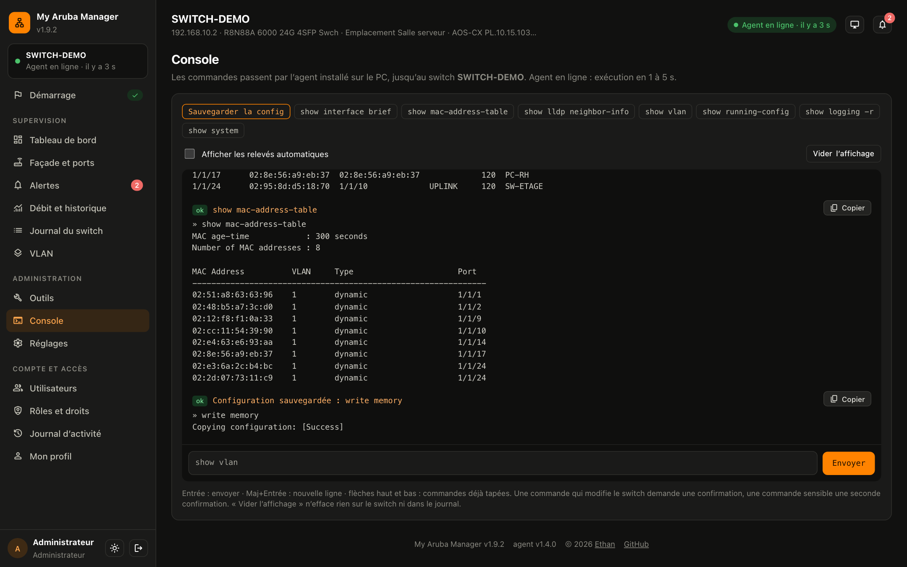

# My Aruba Manager installation guide

*Version française : [GUIDE.md](GUIDE.md)*

This guide takes you step by step from nothing to your switch shown in your browser.
You do not need to be a developer: just follow the steps in order.
Allow **about 20 minutes**, not counting downloads.

Once the dashboard is online, a **setup assistant** repeats these steps inside the page and checks each one live.
This guide is the reference, with more details and solutions to common problems.

The dashboard interface is in French. Labels are quoted in French, with a translation in parentheses.

## Start with the video (30 s)

[](../public/media/my-aruba-manager.mp4)

The animation above plays the 30-second presentation (no sound). **[Download the MP4 video](../public/media/my-aruba-manager.mp4)**
(7 MB: on the GitHub page that opens, click "View raw"). It also plays inside the dashboard, in the setup assistant.

What the video shows: the live front panel of the switch, port by port; the "who is plugged in where" table
(name, IP address, MAC address); a faulty cable tested pair by pair; VLANs, the console and alerts by e-mail
or webhook; and finally how it works: switch, agent, Vercel, browser, without opening a single port.

## Contents

- [What you need](#what-you-need)
- [How it works](#how-it-works)
- [1. Deploy on Vercel](#1-deploy-on-vercel) (5 min)
- [2. Add Supabase and redeploy](#2-add-supabase-and-redeploy) (3 min)
- [3. First login and setup assistant](#3-first-login-and-setup-assistant) (2 min)
- [4. Secure your account](#4-secure-your-account) (3 min)
- [5. Prepare the switch](#5-prepare-the-switch) (2 min)
- [6. Install the agent on the Windows PC](#6-install-the-agent-on-the-windows-pc) (5 to 10 min)
- [7. Check the connection](#7-check-the-connection) (1 min)
- [8. Invite your team and set up alerts](#8-invite-your-team-and-set-up-alerts) (3 min, optional)
- [Troubleshooting](#troubleshooting)
- [Updating](#updating)

## What you need

Tick each line before you start:

- [ ] An **HPE Aruba Networking CX** switch (AOS-CX 10.x) with a **management IP address**.
- [ ] The switch **SSH account** (often `admin`) and **its password**.
- [ ] A **Windows 10 or 11 PC that stays on**, connected to the same network as the switch, with internet access.
      You must be able to log in to it as an **administrator**.
- [ ] A **GitHub** account (free): Vercel stores your copy of the project there.
- [ ] A **Vercel** account (Hobby plan, free). You can create it with your GitHub account.
      Nothing to create at Supabase: the database is added from Vercel.
- [ ] A **phone** with an authenticator app (Google Authenticator, Microsoft Authenticator, and so on).

> **Warning**: Vercel's Hobby plan is limited to personal, non-commercial use.
> For a school or an organization, have this choice approved by the person in charge (see the
> "Limits of the Vercel mode" section of the [README](../README.md#limits-of-the-vercel-mode)).

## How it works


- The **switch** has a private address: the internet cannot reach it.
- The **agent**, a small Python program on a PC of the network, reads the switch over SSH.
- The agent sends the switch state to **Vercel** (the page and the API) over HTTPS. The agent always contacts Vercel:
  **no port to open** on your network.
- **Supabase** keeps the data (history, settings, accounts).
- You open the dashboard in your **browser**, from anywhere.

---

## 1. Deploy on Vercel

Time: 5 minutes

### Prepare the three values

Vercel will ask for three values. Prepare them before you click:

| Variable | What it is for | What to enter |
|---|---|---|
| `DASHBOARD_PASSWORD` | password of the dashboard `admin` account | a strong, unique password (12 characters or more) |
| `SESSION_SECRET` | key that signs the sessions | a random key (command below) |
| `AGENT_TOKEN` | token shared by the dashboard and the agent | another random key (command below) |

**On Windows**: open the Start menu, type `PowerShell`, open **Windows PowerShell**, paste this line and press Enter:

```powershell
$b = New-Object byte[] 32; [Security.Cryptography.RandomNumberGenerator]::Create().GetBytes($b); [Convert]::ToBase64String($b)
```

A long string of characters is shown: that is your key. Run the command **twice**: one key for
`SESSION_SECRET`, another one for `AGENT_TOKEN`.

**On macOS or Linux**: open the Terminal and type:

```sh
openssl rand -base64 32
openssl rand -hex 32
```

The first line gives `SESSION_SECRET`, the second one `AGENT_TOKEN`.

> **Warning**: these values are secrets. Keep them in a password manager.
> Never paste them into a message, a ticket, a screenshot or a GitHub repository.

### Start the deployment


1. Click this button:

   [](https://vercel.com/new/clone?repository-url=https%3A%2F%2Fgithub.com%2Fethanfrq%2FArubaDashboardSwitch&env=DASHBOARD_PASSWORD,SESSION_SECRET,AGENT_TOKEN&envDescription=Dashboard%20password%2C%20session%20key%20and%20agent%20token&envLink=https%3A%2F%2Fgithub.com%2Fethanfrq%2FArubaDashboardSwitch%2Fblob%2Fmain%2Fdocs%2FGUIDE.en.md%231-deploy-on-vercel&project-name=my-aruba-manager&repository-name=my-aruba-manager&stores=%5B%7B%22type%22%3A%22integration%22%2C%22integrationSlug%22%3A%22supabase%22%2C%22productSlug%22%3A%22supabase%22%7D%5D)

2. Log in to Vercel (or create your account with GitHub).
3. **Create Git Repository**: choose your GitHub account, keep the suggested name, then click **Create**.
   Vercel copies the project there.
4. **Supabase**: Vercel offers to add the database. Accept, choose the free plan (**Free**)
   and the **Paris** region (shown as `cdg1` or `eu-west-3` depending on the screen), then confirm.
5. **Environment Variables**: paste the three values prepared above, each one in its field.
6. Click **Deploy** and wait until it finishes (1 to 2 minutes).

**You should see** a congratulations message and a preview of your dashboard.
Write down its address, such as `https://your-project.vercel.app`: this is the address to open in your browser.

> **Warning**: if Vercel did not offer Supabase (or if you skipped that screen), no problem:
> step 2 explains how to add it by hand.

## 2. Add Supabase and redeploy

Time: 3 minutes · **only if Supabase was not added during the deployment**

To check: in your Vercel project, open the **Storage** tab. If a Supabase database is already listed,
go to [step 3](#3-first-login-and-setup-assistant).


1. In your Vercel project, open the **Storage** tab, then click **Create Database**.
2. Choose **Supabase** (Vercel Marketplace), then click **Create**.
3. Keep the **Free** plan, choose the **Paris** region (cdg1, eu-west-3), then **Continue**.
4. **Connect Project**: connect the database to your project, with the **Production** environment ticked, then **Connect**.
   Vercel adds the connection variables by itself (including `POSTGRES_URL`): there is nothing to copy.
5. **Redeploy**: **Deployments** tab, three-dot menu of the latest deployment, **Redeploy**.

**You should see** a new finished deployment (green **Ready** badge).

> **Warning**: always redeploy after adding Supabase or changing a variable.
> Vercel only takes new variables into account on the next deployment.

On first launch, the dashboard creates its tables and schedules its 5-minute check in Supabase by itself.
There is no script to run.

## 3. First login and setup assistant

Time: 2 minutes

Open the address of your dashboard (`https://…vercel.app`).

**If the page shows "Installation à terminer"** (installation to finish), something is missing. The card starts with the
**Voir la présentation (30 s)** (watch the presentation) link, then lists each item with its status (**OK**, or what is wrong), and a short
tutorial for each item to fix:


- **Base de données** (database) marked **Absente** (missing) or **Injoignable** (unreachable): do [step 2](#2-add-supabase-and-redeploy).
- **A variable** marked **Manquante** (missing) (`SESSION_SECRET`, `AGENT_TOKEN` or `DASHBOARD_PASSWORD`): add it in Vercel
  (see ["A variable is missing or wrong"](#a-variable-is-missing-or-wrong) in the troubleshooting section).
- Redeploy the project (**Deployments**, three-dot menu, **Redeploy**), then click **Revérifier** (check again).

The page never shows the value of a variable, only its name.

**When everything is ready**, the login form is shown with the **Première connexion** (first login) box:


1. **Identifiant ou e-mail** (identifier or e-mail): type `admin`.
2. **Mot de passe** (password): the value of `DASHBOARD_PASSWORD` chosen in step 1.
3. Click **Se connecter** (log in).

The **Voir la présentation (30 s)** (watch the presentation) link opens the video again if you want to see it.

**You should see** the **setup assistant** open by itself, with the welcome video:


- Click **Commencer** (start). The assistant covers steps 3 to 8 of this guide, with its own numbering:
  from 1 (**Installation**) to 7 (**Inviter l’équipe**, invite the team). This guide therefore names each assistant step.
- Each step shows its status, checked live: **Fait** (done), **À faire** (to do) or **En attente** (waiting).
- **Précédent** (previous) and **Suivant** (next) move between steps; steps already done can still be opened.
- **Plus tard** (later) closes the assistant. You can reopen it at any time from the sidebar: **Démarrage** (getting
  started) entry, with your progress, for example "3/7".

### If the automatic check fails

In the assistant, the **Installation** step checks the database, the variables and the **automatic check**
(the job scheduled every 5 minutes in Supabase). If the latter fails, enable two extensions
in Supabase:


1. In your Vercel project, **Storage** tab, open your database, then **Open in Supabase**.
2. In Supabase, open the **Database** menu, then **Extensions**.
3. Search for `pg_cron` and enable it. Do the same for `pg_net`.

**You should see** both switches turned on (green). Go back to the assistant, **Installation** step, and click
**Revérifier** (check again): the dashboard immediately tries again to schedule the check (at most once a minute).
Otherwise, it tries again by itself within one hour at most.

## 4. Secure your account

Time: 3 minutes · in the assistant: "Sécuriser ton compte" (secure your account) step

The dashboard can be reached from the internet: your password and two-factor authentication protect it.


### Choose your own password

1. Open **Mon profil** (my profile) from the sidebar, or with the assistant's button.
2. **Mot de passe** (password) card: in **Mot de passe actuel** (current password), type the value of
   `DASHBOARD_PASSWORD` (the password chosen in step 1).
3. Choose a **Nouveau mot de passe** (new password, at least 10 characters), confirm it, then click
   **Changer le mot de passe** (change password).

`DASHBOARD_PASSWORD` stays valid for the `admin` account as a **backup password**. Keep it long and secret.

### Enable two-factor authentication

1. **Double authentification** (two-factor authentication) card: click **Activer la double authentification** (enable).
2. Scan the QR code with your app (Google Authenticator, Microsoft Authenticator, and so on).
3. Type the 6-digit code shown by the app, then click **Activer** (enable).
4. **Download the recovery codes** (**Télécharger les codes** button) and keep them somewhere safe.
   Each one allows a single login if you lose your phone. They will not be shown again.


**You should see** two-factor authentication marked as active, and both items marked **Fait** (done) and **Activée** (enabled) in the assistant.

## 5. Prepare the switch

Time: 2 minutes · in the assistant: "Préparer le switch" (prepare the switch) step

The agent connects to the switch over **SSH**. You need:

- the **management IP** of the switch (in this guide: `192.168.10.2`);
- an **SSH account** on the switch (often `admin`) and its password;
- the **agent's PC** must be able to reach that IP.

### The simplest test

On the PC that will run the agent, open the **Command Prompt** (Start menu, type `cmd`) and type:

```bat
ssh admin@192.168.10.2
```

Replace `admin` and the IP with yours. On the first connection, answer `yes`, then type the switch password.

**You should see** the switch prompt (for example `SWITCH-DEMO#`). SSH is enabled and reachable:
type `exit` and go to [step 6](#6-install-the-agent-on-the-windows-pc).

Otherwise, check and enable SSH with the commands below.

### Check and enable SSH on the switch


These commands are typed **on the switch**, **not in the dashboard**: the dashboard only talks to the switch once
the agent is connected. Two ways to reach it:

- over **SSH**, if that already works (see the test above);
- otherwise with the **console cable** plugged into the switch console port and software such as **PuTTY**
  (connection type **Serial**, the cable's `COM` port, speed **115200**), then the `admin` account.

1. Check where SSH is enabled:

   ```
   show ssh server all-vrfs
   ```

   **You should see** a "SSH server configuration on VRF default" (or `mgmt`) block for the VRF you use.
   The **VRF** is the network through which you reach the switch: `default` for the regular ports, `mgmt` for the
   MGMT management port.

2. Check the management IP:
   - switch with a **dedicated management port** (marked MGMT, for example the 6200, 6300 and 6400):

     ```
     show interface mgmt
     ```

   - otherwise (for example on a 6000, which has no management port): the IP is on a VLAN, often VLAN 1:

     ```
     show ip interface vlan1
     ```

3. If SSH is not enabled on the right VRF, enable it, then save:

   ```
   configure terminal
   ssh server vrf default
   end
   write memory
   ```

   Replace `default` with `mgmt` if the agent's PC goes through the MGMT management port.

> **Warning**: on the 4100i, 6000 and 6100, only the `default` VRF exists: use `ssh server vrf default`.
> SSH only works once the password of the switch `admin` account has been set.

## 6. Install the agent on the Windows PC

Time: 5 to 10 minutes (depending on the Python download) · in the assistant: "Préparer le PC" (prepare the PC),
"Configurer l’agent" (configure the agent), then "Installer et connecter" (install and connect) steps

> **Warning**: this PC must **stay on all the time** and never go to sleep.
> Set sleep to **Never**: Settings, System, Power.

### 6.1 Install Python 3

1. Go to [python.org/downloads](https://www.python.org/downloads/).
2. Under the main button, click the **standalone installer** link ("Or get the standalone installer for
   Python 3.x.x"): you download `python-3.x.x-amd64.exe`.
3. Run that file. **On the first screen, tick "Add python.exe to PATH"**, then click **Install Now**.


**You should see** "Setup was successful".

> **Warning**: without the **Add python.exe to PATH** box, Windows will not find the `python` command
> and the agent installation will fail. If you forgot it, run the installer again and choose to repair
> or modify it, or uninstall Python and install it again with the box ticked.

To check: open a **new** Command Prompt and type `python --version`.
**You should see** `Python 3.` followed by the version number.

### 6.2 Download the agent

1. Open the [latest published release](https://github.com/ethanfrq/ArubaDashboardSwitch/releases/latest).
2. Under **Assets**, download `aruba-agent-x.y.z.zip`.
3. Right-click the zip file, **Extract All…** (**Extraire tout…** on a French Windows), type `C:\` as the destination,
   then **Extract**.
4. Rename the `C:\aruba-agent-x.y.z` folder to `aruba-agent`.


**You should see** the agent files directly in `C:\aruba-agent`: `agent.py`, `installer-service.bat`,
`requirements.txt`, `agent_config.example.json`, and so on (and not a second folder inside).

### 6.3 Install the dependencies

1. Open `C:\aruba-agent` in File Explorer.
2. Click the address bar, type `cmd` and press Enter: a Command Prompt opens in that folder.
3. Type:

   ```bat
   python -m pip install -r requirements.txt
   ```

**You should see** "Successfully installed" followed by `paramiko` and its dependencies.

`pip install -r requirements.txt` does the same; `python -m pip` works even when Windows cannot find `pip`.

### 6.4 Download agent_config.json from the dashboard

In the assistant, **Configurer l’agent** (configure the agent) step:

1. **Adresse IP du switch** (switch IP address): the management IP (here `192.168.10.2`). Required.
2. **Compte SSH du switch** (switch SSH account): often `admin`.
3. **Réseau à scanner (facultatif)** (network to scan, optional): the network of the devices, with its prefix, for example
   `192.168.10.0/24`. The agent looks up the IP addresses of the connected devices there (prefix from /22 to /30:
   1024 addresses at most). Leave it empty if you are not sure.
4. Click **Télécharger agent_config.json** (download agent_config.json).
5. Move the downloaded file into `C:\aruba-agent`, next to `agent.py`, with the exact name `agent_config.json`.
   This is the file the agent reads; `agent_config.example.json` can stay next to it.


The file is **already filled in**: dashboard address, agent token, switch IP. The switch SSH password
is never in it: it is asked in the next step and encrypted by Windows.

> **Warning**: `agent_config.json` contains the **agent token**. Do not share it, do not send it by e-mail,
> **never publish it** (GitHub, forum, screenshot). If that happened: change `AGENT_TOKEN` in Vercel,
> redeploy, then download a new file.

- If the browser renamed the file (`agent_config (1).json`), rename it to `agent_config.json`.
- If the dashboard first asks you to enable two-factor authentication, do [step 4](#4-secure-your-account).
- Prefer the manual method (copy the example and fill it in)? See
  [`agent/INSTALL-WINDOWS.md`](../agent/INSTALL-WINDOWS.md).

### 6.5 Install the agent as a service

In the assistant, **Installer et connecter** (install and connect) step:

1. In `C:\aruba-agent`, **right-click** `installer-service.bat`.
2. Choose **Run as administrator** (**Exécuter en tant qu’administrateur** on a French Windows), then **Yes**
   in the Windows prompt. If Windows first shows a warning ("Windows protected your PC", or "Security Warning"),
   click **More info** then **Run anyway**, or **Run**: the file comes from the official releases page.


3. A black window asks for the **switch SSH password** ("Mot de passe SSH de admin@192.168.10.2 :").
   Type it and press Enter. The characters are not shown while you type: this is normal.


**You should see** "Mot de passe enregistré (chiffré)." (password saved, encrypted) then "Service installé et démarré"
(service installed and started). Press any key to close the window.

The agent now runs in the background, without a window. It starts with Windows, even when nobody is logged in,
restarts by itself after an error and updates itself from the published versions.

## 7. Check the connection

Time: 1 minute · in the assistant: "Installer et connecter" (install and connect) step

Go back to the dashboard. The assistant shows **En attente de l’agent…** (waiting for the agent) then, within a minute:


**You should see** "Agent connecté" (agent connected) with the name of your switch, its number of ports and the agent
version (here "SWITCH-DEMO (28 ports)"). At the top of the dashboard, the badge shows **Agent en ligne** (agent online).


If the agent is still waiting after 2 minutes, open the assistant's troubleshooting panel or the
[The agent does not connect](#the-agent-does-not-connect) section.

**The console.** To type commands on the switch (administrator accounts): open **Console** in the sidebar
(**Administration** group), or click **Ouvrir en grand** (open full size) on the dashboard's **Console de gestion**
(management console) card. The page shows the same console over the full height of the screen: quick commands, the
output of each command with a **Copier** (copy) button, and the commands already typed brought back with the up and
down arrows. A command that changes the switch asks for confirmation. The dashboard's automatic readings (link state,
spanning-tree, switch log, cable tests, and so on) are hidden by default: tick **Afficher les relevés automatiques**
(show automatic readings) to see them.



## 8. Invite your team and set up alerts

Time: 3 minutes · optional · in the assistant: "Inviter l’équipe" (invite the team) step

### Create accounts

One account per person: everyone has their own password, and their actions are signed in the activity log.

1. Open **Utilisateurs** (users) from the sidebar, or with the assistant's **Créer des comptes** (create accounts) button.
2. Click **Nouvel utilisateur** (new user).
3. Enter the **Nom** (name) and the **Identifiant ou e-mail** (identifier or e-mail).
4. Choose the **Rôle** (role):
   - **Administrateur** (administrator): everything, including accounts;
   - **Technicien** (technician): works on access ports, no console and no settings;
   - **Lecture seule** (read-only): watches without changing anything (ideal for a wall screen).
5. **Mot de passe** (password): keep **Lien d’invitation** (invitation link, recommended, valid 48 h) or choose it now.
6. Click **Créer le compte** (create the account), then send the link to the person.


At their first login, each person sees a welcome window with the video and what their role allows:


### Receive alerts

1. Open the **Réglages** (settings) page: from the sidebar, with the assistant's **Régler les alertes** (set up alerts)
   button, or with the **Réglages** button of the **Alertes récentes** (recent alerts) card.
2. In the **Où envoyer les alertes** (where to send alerts) card, fill in **E-mail(s)** and/or **Webhook** (Teams,
   Discord, Slack, ntfy for your phone, and so on).
3. Tick the events to report under **Prévenir quand…** (notify when), then choose the **Ports surveillés** (monitored
   ports): **Automatique** (links to other switches and ports with a description) or **Manuel** (manual),
   by clicking the ports.
4. As soon as something changes, a bar appears at the bottom of the page: click **Enregistrer** (save).
   **Annuler** (cancel) brings back the saved values. If you leave the page or log out without saving, the dashboard
   asks you to confirm.
5. Click **Envoyer un test** (send a test), in the **Où envoyer les alertes** card: you should receive the test message.
   The test uses the saved settings: the button stays greyed out while there are unsaved changes.


**E-mail** alerts go through **Resend**: add Resend from the Vercel Marketplace, then redeploy.
Without a verified domain, Resend only writes to the address of your own Resend account (default sender
`onboarding@resend.dev`). To write to other addresses, verify your domain in Resend, then set the `ALERT_FROM`
variable to that domain (for example `Switch <alerts@my-domain.com>`).
Other optional variable: `DASHBOARD_URL` (link included in the alerts). Webhooks need no additional service.

### Finish

In the assistant, click **Terminer** (finish). **You should see** the dashboard, and the **Démarrage** entry marked with a check mark.

---

## Troubleshooting

### A variable is missing or wrong


1. In your Vercel project: **Settings**, then **Environment Variables**.
2. Add or fix `DASHBOARD_PASSWORD`, `SESSION_SECRET` or `AGENT_TOKEN` (keep **All Environments**, or at least **Production**).
3. Redeploy (**Deployments**, three-dot menu, **Redeploy**), then click **Revérifier** (check again) in the dashboard.

> **Warning**: keep `SESSION_SECRET` unchanged once the installation is done: changing it logs everyone out.
> If you change `AGENT_TOKEN`, the agent can no longer connect: download a new `agent_config.json`
> (step 6.4), put it in `C:\aruba-agent`, then [restart the agent](#restart-the-agent).

### I cannot log in

- The identifier of the first account is `admin`. The password is `DASHBOARD_PASSWORD`, exactly as in Vercel.
- Did you change `DASHBOARD_PASSWORD` in Vercel? Redeploy so that it is taken into account.
- After 8 failed attempts, login is blocked for 15 minutes ("Trop de tentatives", too many attempts). Wait, then try again.
- Forgotten password: an administrator sends you a link from **Utilisateurs**. For the `admin` account,
  `DASHBOARD_PASSWORD` always works as a backup.
- Lost phone (two-factor authentication): use a recovery code, or follow the
  "Lost phone" section of the [README](../README.md#lost-phone-two-factor-authentication).

### The automatic check fails

Enable `pg_cron` and `pg_net` in Supabase: see [If the automatic check fails](#if-the-automatic-check-fails).

### The agent does not connect

Check in this order:

1. **The PC is on and not asleep**, and it has internet access.
2. **The service is running**: open a Command Prompt **as administrator** (Start menu, type `cmd`, right-click
   **Command Prompt**, **Run as administrator**), then type:

   ```bat
   cd /d C:\aruba-agent
   python installer_service.py status
   ```

   To restart it, [restart the agent](#restart-the-agent).
3. **Read the log** `C:\aruba-agent\agent.log` (open it with Notepad), starting from the end:

| Message in agent.log | Cause | Solution |
|---|---|---|
| "Mot de passe SSH refusé par le switch" (SSH password refused) | wrong SSH password | run `installer-service.bat` again as administrator and type the password again |
| "Switch injoignable" or "Liaison switch perdue" (switch unreachable, link lost) | wrong IP, SSH disabled or blocked | check the IP and SSH ([step 5](#5-prepare-the-switch)), and test `ssh admin@IP` from this PC |
| "Dashboard : HTTP 401" | agent token different from `AGENT_TOKEN` | download a new `agent_config.json` (step 6.4), then [restart the agent](#restart-the-agent) |
| "Dashboard injoignable" (dashboard unreachable) | no internet, firewall, proxy or wrong address | check `dashboard_url` in `agent_config.json` and that the PC can open the dashboard address in a browser |

- `installer-service.bat` shows an error about `agent_config.json` not found (FileNotFoundError): the file is missing
  from `C:\aruba-agent` or has another name (Windows sometimes hides the extension: `agent_config.json.txt`).
- "python" is not recognized, "Python was not found", or the **Microsoft Store** opens when you type `python`:
  Python is not in the PATH (box not ticked, or Python installed with another Windows account than the one running
  `installer-service.bat`). Install it again with **Add python.exe to PATH** ticked: see [step 6.1](#61-install-python-3).
- A company firewall must let the PC go out over **HTTPS** (port 443) to your `vercel.app` address and to
  `api.github.com` (automatic update of the agent), and reach the switch over **SSH** (port 22).
  No inbound port needs to be opened.

### Restart the agent

After a change to `agent_config.json` (new token, network to scan, and so on), the agent must restart to read it.
The simplest way: in `C:\aruba-agent`, right-click `installer-service.bat`, **Run as administrator**, then press
**Enter without typing anything** when the SSH password is asked ("Rien de changé.", nothing changed: the saved
password is kept). The service is stopped and started again, and the window shows "Service installé et démarré".

### The switch log says the agent is old

The box "L’agent installé sur le PC est ancien : mets-le à jour" (the agent installed on the PC is old: update it)
appears above the **Journal du switch** (switch log), with the line "L’agent du PC est ancien : mets-le à jour" in the
**Switch** card, when the PC's agent predates version 1.3.0 and the switch readings fail. The bottom of the page then
shows "agent : version antérieure à 1.3.0" (version older than 1.3.0). Such an agent does not update itself: update it
by hand once.

1. Click **Mettre à jour l’agent** (update the agent) in the box (steps in French), or follow [The agent](#the-agent)
   under "Updating": it leads to the same steps in English, in
   [`agent/INSTALL-WINDOWS.md`](../agent/INSTALL-WINDOWS.md#upgrading-from-an-old-version-before-130).
2. On the agent's PC, open PowerShell **as administrator**, go to `C:\aruba-agent`, then paste the two lines given
   there (configuration and password kept).
3. **You should see**, a few minutes later, the version number at the bottom of the dashboard (for example
   "agent v1.4.0"), and the box disappears. After that, the agent updates itself.

Without the box, if the log shows "Relevé impossible" (reading failed), the cause is spelled out (SSH password refused,
switch not answering, and so on): see [The agent does not connect](#the-agent-does-not-connect).

### Devices have no IP address

Fill in the **Réseau à scanner (facultatif)** (network to scan, for example `192.168.10.0/24`) in step 6.4, download the new file,
replace the old one and [restart the agent](#restart-the-agent). The agent looks up the IP addresses every 5 minutes.

### The dashboard stops responding after a week without the agent

The Supabase free plan pauses the project after 7 days without activity. The agent writes continuously,
so this only happens if the PC stays off for a week. Open your project on supabase.com and resume it
(**Restore project**).

---

## Updating

### The agent

Nothing to do: it updates itself, only from the versions published on the
[Releases](https://github.com/ethanfrq/ArubaDashboardSwitch/releases) page. The bottom of the dashboard shows
"mise à jour auto" (automatic update) followed by a green check mark (an orange triangle if the last check
failed). Details: [`agent/INSTALL-WINDOWS.md`](../agent/INSTALL-WINDOWS.md#automatic-update).

An agent installed before version 1.3.0 does not update itself: the dashboard says so with the box
"L’agent installé sur le PC est ancien : mets-le à jour" (the agent installed on the PC is old: update it) above the
switch log (and a line in the Switch card), and the bottom of the page shows "agent : version antérieure à 1.3.0". The
box's link leads to the steps in French; in English, they are in [`agent/INSTALL-WINDOWS.md`](../agent/INSTALL-WINDOWS.md#upgrading-from-an-old-version-before-130):
two lines to paste once into PowerShell, configuration and password kept; after that, everything is automatic.

### The dashboard

The Deploy button created **your own copy** of the project on GitHub: it does not follow new versions by itself.
Before each update, read the [`CHANGELOG.md`](../CHANGELOG.md) (in French, "Passer de la … à la …" section: upgrading from … to …).

**The simplest way (once): switch to a fork.**

1. On [the project page](https://github.com/ethanfrq/ArubaDashboardSwitch), click **Fork** to create your fork.
2. In your Vercel project: **Settings**, **Git**, disconnect the current repository, then connect your fork.
   The variables and the Supabase database stay attached to the Vercel project: nothing is lost.
3. Then, for each new version: on your fork, **Sync fork** then **Update branch**.
   Vercel redeploys by itself.

**With Git** (if you are comfortable with the command line). Replace `YOUR-ACCOUNT/YOUR-REPO` with your copy:

```sh
git clone https://github.com/YOUR-ACCOUNT/YOUR-REPO.git
cd YOUR-REPO
git pull --no-rebase -X theirs --allow-unrelated-histories https://github.com/ethanfrq/ArubaDashboardSwitch.git main
git push
```

Vercel redeploys by itself after the `git push`.

---

*Guide for [My Aruba Manager](../README.md). Found a mistake, or a step that is not clear?
Open an [issue](https://github.com/ethanfrq/ArubaDashboardSwitch/issues) (without IP addresses, passwords or tokens).*
