# Guide d’installation de My Aruba Manager

*English version: [GUIDE.en.md](GUIDE.en.md)*

Ce guide t’accompagne pas à pas, de zéro jusqu’à ton switch affiché dans le navigateur.
Pas besoin d’être développeur : il suffit de suivre les étapes dans l’ordre.
Compte **environ 20 minutes**, sans les téléchargements.

Une fois le dashboard en ligne, un **assistant de démarrage** reprend ces étapes dans la page et vérifie chacune en direct.
Ce guide sert de référence, avec plus de détails et des solutions aux problèmes courants.

## Commence par la vidéo (30 s)

[](../public/media/my-aruba-manager.mp4)

L’animation ci-dessus montre la présentation de 30 secondes (sans son). **▶ [Télécharger la vidéo MP4](../public/media/my-aruba-manager.mp4)**
(7 Mo : sur la page GitHub qui s’ouvre, clique sur « View raw »). Elle se lit aussi dans le dashboard, dans l’assistant de démarrage.

Ce que montre la vidéo : la façade du switch en direct, port par port ; le tableau « qui est branché où »
(nom, adresse IP, adresse MAC) ; le test d’un câble défectueux paire par paire ; les VLAN, la console et les alertes
par e-mail ou webhook ; enfin le fonctionnement : switch, agent, Vercel, navigateur, sans ouvrir un seul port.

## Sommaire

- [Ce qu’il faut](#ce-quil-faut)
- [Comment ça marche](#comment-ça-marche)
- [1. Déployer sur Vercel](#1-déployer-sur-vercel) (5 min)
- [2. Ajouter Supabase et redéployer](#2-ajouter-supabase-et-redéployer) (3 min)
- [3. Première connexion et assistant](#3-première-connexion-et-assistant) (2 min)
- [4. Sécuriser ton compte](#4-sécuriser-ton-compte) (3 min)
- [5. Préparer le switch](#5-préparer-le-switch) (2 min)
- [6. Installer l’agent sur le PC Windows](#6-installer-lagent-sur-le-pc-windows) (5 à 10 min)
- [7. Vérifier la connexion](#7-vérifier-la-connexion) (1 min)
- [8. Inviter l’équipe et régler les alertes](#8-inviter-léquipe-et-régler-les-alertes) (3 min, facultatif)
- [Dépannage](#dépannage)
- [Mettre à jour](#mettre-à-jour)

## Ce qu’il faut

Coche chaque ligne avant de commencer :

- [ ] Un switch **HPE Aruba Networking CX** (AOS-CX 10.x) avec une **adresse IP de gestion**.
- [ ] Le **compte SSH** du switch (souvent `admin`) et **son mot de passe**.
- [ ] Un **PC Windows 10 ou 11 allumé en permanence**, branché sur le même réseau que le switch, avec accès à internet.
      Tu dois pouvoir y ouvrir une session **administrateur**.
- [ ] Un compte **GitHub** (gratuit) : Vercel y range ta copie du projet.
- [ ] Un compte **Vercel** (offre Hobby, gratuite). Tu peux le créer avec ton compte GitHub.
      Rien à créer chez Supabase : la base de données s’ajoute depuis Vercel.
- [ ] Un **téléphone** avec une appli d’authentification (Google Authenticator, Microsoft Authenticator…).

> **Attention** : l’offre Hobby de Vercel est réservée à un usage personnel et non commercial.
> Pour une école ou une structure, fais valider ce choix par le responsable (voir la section
> « Limites du mode Vercel » du [README](../README.fr.md#limites-du-mode-vercel)).

## Comment ça marche


- Le **switch** a une adresse privée : internet ne peut pas le joindre.
- L’**agent**, un petit programme Python sur un PC du réseau, lit le switch en SSH.
- L’agent envoie l’état du switch à **Vercel** (la page et l’API) en HTTPS. C’est toujours lui qui contacte Vercel :
  **aucun port à ouvrir** sur ton réseau.
- **Supabase** garde les données (historique, réglages, comptes).
- Tu ouvres le dashboard dans ton **navigateur**, depuis n’importe où.

---

## 1. Déployer sur Vercel

⏱ 5 minutes

### Prépare les trois valeurs

Vercel va te demander trois valeurs. Prépare-les avant de cliquer :

| Variable | À quoi elle sert | Quoi mettre |
|---|---|---|
| `DASHBOARD_PASSWORD` | mot de passe du compte `admin` du dashboard | un mot de passe solide et unique (12 caractères ou plus) |
| `SESSION_SECRET` | clé qui signe les sessions | une clé aléatoire (commande ci-dessous) |
| `AGENT_TOKEN` | jeton partagé entre le dashboard et l’agent | une autre clé aléatoire (commande ci-dessous) |

**Sous Windows** : ouvre le menu Démarrer, tape `PowerShell`, ouvre **Windows PowerShell**, colle cette ligne puis appuie sur Entrée :

```powershell
$b = New-Object byte[] 32; [Security.Cryptography.RandomNumberGenerator]::Create().GetBytes($b); [Convert]::ToBase64String($b)
```

Une longue suite de caractères s’affiche : c’est ta clé. Lance la commande **deux fois** : une clé pour
`SESSION_SECRET`, une autre pour `AGENT_TOKEN`.

**Sous macOS ou Linux** : ouvre le Terminal et tape :

```sh
openssl rand -base64 32
openssl rand -hex 32
```

La première ligne donne `SESSION_SECRET`, la seconde `AGENT_TOKEN`.

> **Attention** : ces valeurs sont des secrets. Range-les dans un gestionnaire de mots de passe.
> Ne les colle jamais dans un message, un ticket, une capture d’écran ou un dépôt GitHub.

### Lance le déploiement

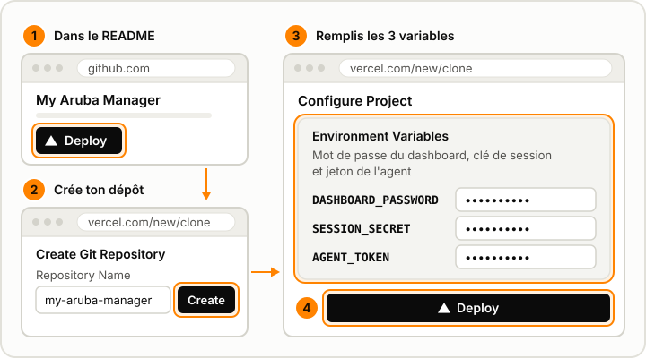

1. Clique sur ce bouton :

   [](https://vercel.com/new/clone?repository-url=https%3A%2F%2Fgithub.com%2Fethanfrq%2FArubaDashboardSwitch&env=DASHBOARD_PASSWORD,SESSION_SECRET,AGENT_TOKEN&envDescription=Mot%20de%20passe%20du%20dashboard%2C%20cl%C3%A9%20de%20session%20et%20jeton%20de%20l%27agent&envLink=https%3A%2F%2Fgithub.com%2Fethanfrq%2FArubaDashboardSwitch%2Fblob%2Fmain%2Fdocs%2FGUIDE.md%231-d%C3%A9ployer-sur-vercel&project-name=my-aruba-manager&repository-name=my-aruba-manager&stores=%5B%7B%22type%22%3A%22integration%22%2C%22integrationSlug%22%3A%22supabase%22%2C%22productSlug%22%3A%22supabase%22%7D%5D)

2. Connecte-toi à Vercel (ou crée ton compte avec GitHub).
3. **Create Git Repository** : choisis ton compte GitHub, garde le nom proposé, puis clique sur **Create**.
   Vercel y copie le projet.
4. **Supabase** : Vercel propose d’ajouter la base de données. Accepte, choisis l’offre gratuite (**Free**)
   et la région **Paris** (affichée selon les écrans `cdg1` ou `eu-west-3`), puis valide.
5. **Environment Variables** : colle les trois valeurs préparées plus haut, chacune dans sa case.
6. Clique sur **Deploy** et attends la fin (1 à 2 minutes).

**Tu dois voir** un message de félicitations et un aperçu de ton dashboard.
Note son adresse, du type `https://mon-projet.vercel.app` : c’est l’adresse à ouvrir dans ton navigateur.

> **Attention** : si Vercel ne t’a pas proposé Supabase (ou si tu as passé l’écran), ce n’est pas grave :
> l’étape 2 explique comment l’ajouter à la main.

## 2. Ajouter Supabase et redéployer

⏱ 3 minutes · **à faire seulement si Supabase n’a pas été ajouté pendant le déploiement**

Pour vérifier : dans ton projet Vercel, ouvre l’onglet **Storage**. Si une base Supabase y apparaît déjà,
passe à l’[étape 3](#3-première-connexion-et-assistant).

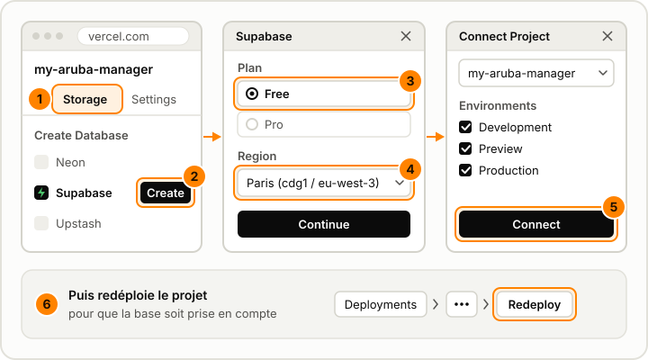

1. Dans ton projet Vercel, ouvre l’onglet **Storage**, puis clique sur **Create Database**.
2. Choisis **Supabase** (Marketplace Vercel), puis clique sur **Create**.
3. Garde l’offre **Free**, choisis la région **Paris** (cdg1, eu-west-3), puis **Continue**.
4. **Connect Project** : relie la base à ton projet, avec l’environnement **Production** coché, puis **Connect**.
   Vercel ajoute tout seul les variables de connexion (dont `POSTGRES_URL`) : il n’y a rien à copier.
5. **Redéploie** : onglet **Deployments**, menu **⋯** du dernier déploiement, **Redeploy**.

**Tu dois voir** un nouveau déploiement terminé (pastille verte **Ready**).

> **Attention** : redéploie toujours après avoir ajouté Supabase ou modifié une variable.
> Vercel ne prend en compte les nouvelles variables qu’au déploiement suivant.

Au premier lancement, le dashboard crée ses tables et programme tout seul sa vérification toutes les 5 minutes
dans Supabase. Il n’y a aucun script à lancer.

## 3. Première connexion et assistant

⏱ 2 minutes

Ouvre l’adresse de ton dashboard (`https://…vercel.app`).

**Si la page affiche « Installation à terminer »**, il manque quelque chose. La carte commence par le lien
**Voir la présentation (30 s)**, puis liste chaque point avec ✓ ou ✗, et un court tutoriel pour chaque ✗ :

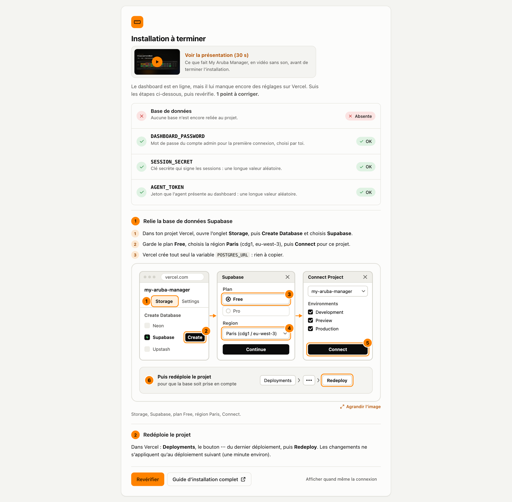

- **Base de données** ✗ : fais l’[étape 2](#2-ajouter-supabase-et-redéployer).
- **Une variable** ✗ (`SESSION_SECRET`, `AGENT_TOKEN` ou `DASHBOARD_PASSWORD`) : ajoute-la dans Vercel
  (voir [« Une variable manque »](#une-variable-manque-ou-est-fausse) dans le dépannage).
- Redéploie le projet (**Deployments**, **⋯**, **Redeploy**), puis clique sur **Revérifier**.

La page ne montre jamais la valeur d’une variable, seulement son nom.

**Quand tout est prêt**, le formulaire de connexion s’affiche avec l’encadré **Première connexion** :

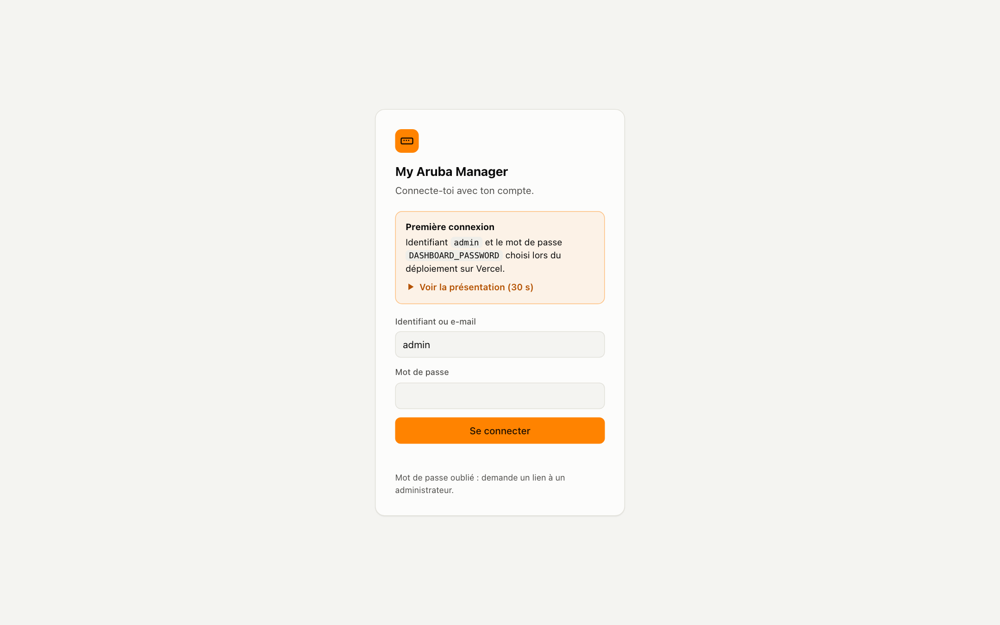

1. **Identifiant ou e-mail** : tape `admin`.
2. **Mot de passe** : la valeur de `DASHBOARD_PASSWORD` choisie à l’étape 1.
3. Clique sur **Se connecter**.

Le lien **Voir la présentation (30 s)** rouvre la vidéo si tu veux la revoir.

**Tu dois voir** l’**assistant de démarrage** s’ouvrir tout seul, avec la vidéo de bienvenue :


- Clique sur **Commencer**. L’assistant reprend les étapes 3 à 8 de ce guide, numérotées à sa façon :
  de 1 (**Installation**) à 7 (**Inviter l’équipe**). Ce guide cite donc chaque étape de l’assistant par son nom.
- Chaque étape affiche son état, vérifié en direct : fait ✓, à faire, ou en attente.
- **Précédent** et **Suivant** permettent de naviguer ; les étapes déjà faites restent consultables.
- **Plus tard** ferme l’assistant. Tu le retrouves à tout moment dans la barre latérale : entrée **Démarrage**
  (avec ta progression, par exemple « 3/7 »).

### Si la vérification automatique est en échec

Dans l’assistant, l’étape **Installation** vérifie la base, les variables et la **vérification automatique**
(la tâche programmée toutes les 5 minutes dans Supabase). Si cette dernière est en échec, active deux extensions
dans Supabase :

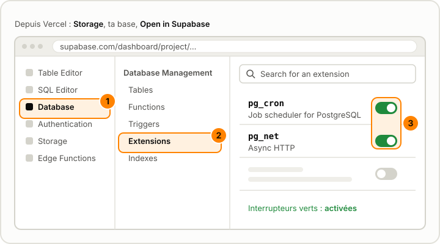

1. Dans ton projet Vercel, onglet **Storage**, ouvre ta base puis **Open in Supabase**.
2. Dans Supabase, menu **Database**, puis **Extensions**.
3. Cherche `pg_cron` et active-la. Fais de même pour `pg_net`.

**Tu dois voir** les deux interrupteurs en vert. Reviens dans l’assistant, étape **Installation**, et clique sur
**Revérifier** : le dashboard réessaie aussitôt de programmer la vérification (une fois par minute au plus).
Sans cela, il réessaie tout seul au plus tard une heure après.

## 4. Sécuriser ton compte

⏱ 3 minutes · dans l’assistant : étape « Sécuriser ton compte »

Le dashboard est accessible depuis internet : ton mot de passe et la double authentification le protègent.

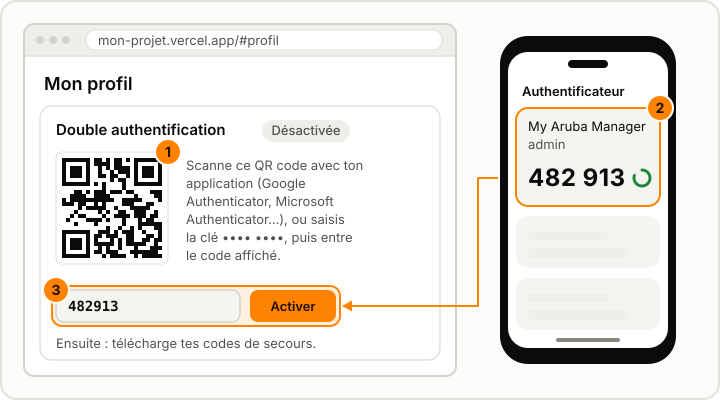

### Choisis ton propre mot de passe

1. Ouvre **Mon profil** (barre latérale, ou bouton de l’assistant).
2. Carte **Mot de passe** : dans **Mot de passe actuel**, tape la valeur de `DASHBOARD_PASSWORD`
   (le mot de passe choisi à l’étape 1).
3. Choisis un **Nouveau mot de passe** (10 caractères au moins), confirme-le, puis clique sur **Changer le mot de passe**.

`DASHBOARD_PASSWORD` reste valable pour le compte `admin` comme **mot de passe de secours**. Garde-le long et secret.

### Active la double authentification

1. Carte **Double authentification** : clique sur **Activer la double authentification**.
2. Scanne le QR code avec ton appli (Google Authenticator, Microsoft Authenticator…).
3. Tape le code à 6 chiffres affiché par l’appli, puis clique sur **Activer**.
4. **Télécharge les codes de secours** (bouton **Télécharger les codes**) et range-les en lieu sûr.
   Chacun permet une seule connexion si tu perds ton téléphone. Ils ne seront plus affichés.

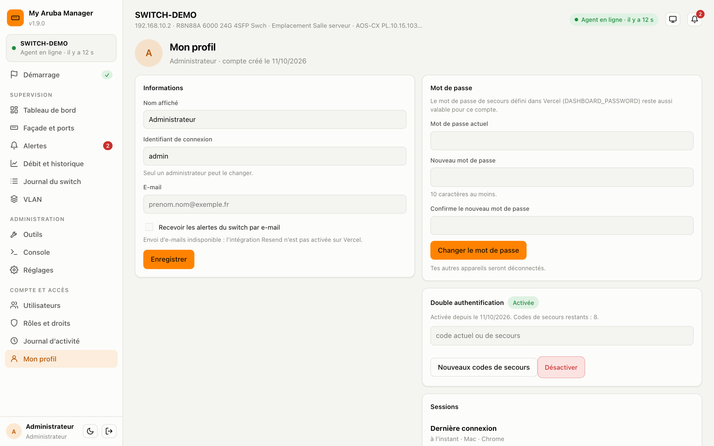

**Tu dois voir** la double authentification marquée comme active, et les deux points cochés ✓ dans l’assistant.

## 5. Préparer le switch

⏱ 2 minutes · dans l’assistant : étape « Préparer le switch »

L’agent se connecte au switch en **SSH**. Il te faut :

- l’**IP de gestion** du switch (dans ce guide : `192.168.10.2`) ;
- un **compte SSH** du switch (souvent `admin`) et son mot de passe ;
- que le **PC de l’agent** puisse joindre cette IP.

### Le test le plus simple

Sur le PC qui recevra l’agent, ouvre l’**Invite de commandes** (menu Démarrer, tape `cmd`) et tape :

```bat
ssh admin@192.168.10.2
```

Remplace `admin` et l’IP par les tiennes. À la première connexion, réponds `yes`, puis tape le mot de passe du switch.

**Tu dois voir** l’invite du switch (par exemple `SWITCH-DEMO#`). SSH est actif et joignable :
tape `exit` et passe à l’[étape 6](#6-installer-lagent-sur-le-pc-windows).

Sinon, vérifie et active SSH avec les commandes ci-dessous.

### Vérifier et activer SSH sur le switch

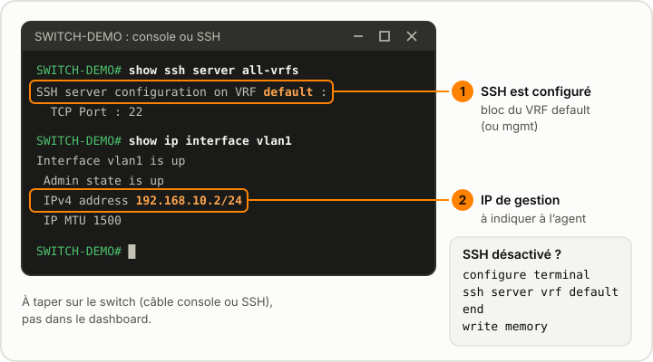

Ces commandes se tapent **sur le switch**, **pas dans le dashboard** : le dashboard ne parle au switch qu’une fois
l’agent connecté. Deux façons d’y accéder :

- en **SSH**, si c’est déjà possible (voir le test ci-dessus) ;
- sinon avec le **câble console** branché sur le port console du switch et un logiciel comme **PuTTY**
  (type de connexion **Serial**, port `COM` du câble, vitesse **115200**), puis le compte `admin`.

1. Vérifie où SSH est actif :

   ```
   show ssh server all-vrfs
   ```

   **Tu dois voir** un bloc « SSH server configuration on VRF default » (ou `mgmt`) pour le VRF que tu utilises.
   Le **VRF** est le réseau par lequel tu joins le switch : `default` pour les ports normaux, `mgmt` pour le port
   de gestion MGMT.

2. Vérifie l’IP de gestion :
   - switch avec un **port de gestion dédié** (marqué MGMT, par exemple les 6200, 6300, 6400) :

     ```
     show interface mgmt
     ```

   - sinon (par exemple sur un 6000, qui n’a pas de port de gestion) : l’IP est portée par un VLAN, souvent le VLAN 1 :

     ```
     show ip interface vlan1
     ```

3. Si SSH n’est pas actif sur le bon VRF, active-le puis sauvegarde :

   ```
   configure terminal
   ssh server vrf default
   end
   write memory
   ```

   Remplace `default` par `mgmt` si le PC de l’agent passe par le port de gestion MGMT.

> **Attention** : sur les 4100i, 6000 et 6100, seul le VRF `default` existe : utilise `ssh server vrf default`.
> SSH ne fonctionne qu’une fois le mot de passe du compte `admin` du switch défini.

## 6. Installer l’agent sur le PC Windows

⏱ 5 à 10 minutes (selon le téléchargement de Python) · dans l’assistant : étapes « Préparer le PC »,
« Configurer l’agent » puis « Installer et connecter »

> **Attention** : ce PC doit rester **allumé en permanence** et ne jamais se mettre en veille.
> Règle la mise en veille sur **Jamais** : Paramètres, Système, Alimentation.

### 6.1 Installer Python 3

1. Va sur [python.org/downloads](https://www.python.org/downloads/).
2. Sous le bouton principal, clique sur le lien **standalone installer** (« Or get the standalone installer for
   Python 3.x.x ») : tu télécharges `python-3.x.x-amd64.exe`.
3. Lance ce fichier. **Sur le premier écran, coche « Add python.exe to PATH »**, puis clique sur **Install Now**.

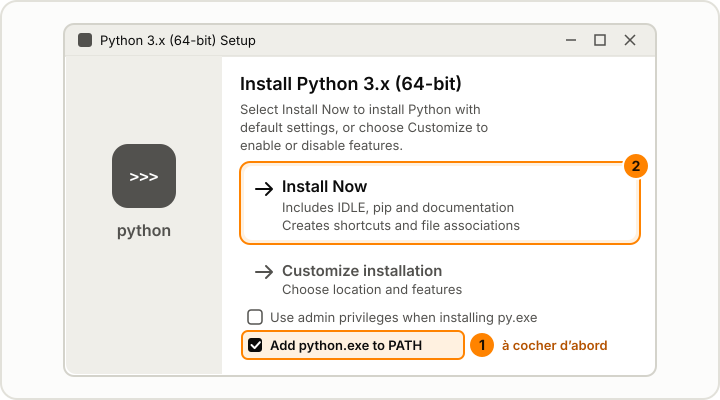

**Tu dois voir** « Setup was successful ».

> **Attention** : sans la case **Add python.exe to PATH**, Windows ne trouvera pas la commande `python`
> et l’installation de l’agent échouera. Si tu l’as oubliée, relance l’installateur et choisis de le réparer
> ou de le modifier, ou désinstalle Python puis réinstalle-le en cochant la case.

Pour vérifier : ouvre une **nouvelle** Invite de commandes et tape `python --version`.
**Tu dois voir** `Python 3.` suivi du numéro de version.

### 6.2 Télécharger l’agent

1. Ouvre la [dernière version publiée](https://github.com/ethanfrq/ArubaDashboardSwitch/releases/latest).
2. Dans **Assets**, télécharge `aruba-agent-x.y.z.zip`.
3. Clic droit sur le fichier zip, **Extraire tout…**, tape `C:\` comme destination, puis **Extraire**.
4. Renomme le dossier `C:\aruba-agent-x.y.z` en `aruba-agent`.

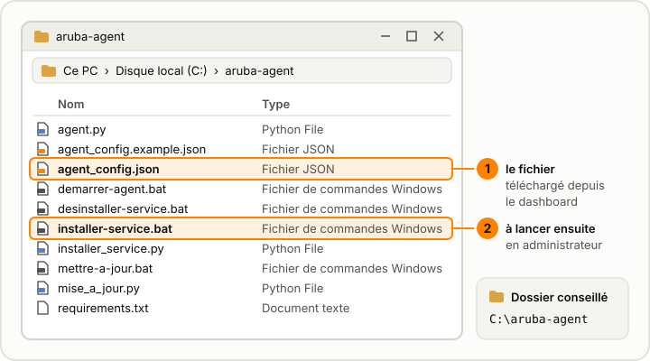

**Tu dois voir** les fichiers de l’agent directement dans `C:\aruba-agent` : `agent.py`, `installer-service.bat`,
`requirements.txt`, `agent_config.example.json`… (et pas un second dossier à l’intérieur).

### 6.3 Installer les dépendances

1. Ouvre `C:\aruba-agent` dans l’Explorateur.
2. Clique dans la barre d’adresse, tape `cmd` et appuie sur Entrée : une Invite de commandes s’ouvre dans ce dossier.
3. Tape :

   ```bat
   python -m pip install -r requirements.txt
   ```

**Tu dois voir** « Successfully installed » suivi de `paramiko` et de ses dépendances.

`pip install -r requirements.txt` fait la même chose ; `python -m pip` fonctionne même quand Windows ne trouve pas `pip`.

### 6.4 Télécharger agent_config.json depuis le dashboard

Dans l’assistant, étape **Configurer l’agent** :

1. **Adresse IP du switch** : l’IP de gestion (ici `192.168.10.2`). Obligatoire.
2. **Compte SSH du switch** : souvent `admin`.
3. **Réseau à scanner (facultatif)** : le réseau des appareils, avec son préfixe, par exemple `192.168.10.0/24`.
   L’agent y cherche les adresses IP des appareils branchés (préfixe de /22 à /30 : 1024 adresses au plus).
   Laisse vide si tu ne sais pas.
4. Clique sur **Télécharger agent_config.json**.
5. Déplace le fichier téléchargé dans `C:\aruba-agent`, à côté de `agent.py`, sous le nom exact `agent_config.json`.
   C’est lui que l’agent lit ; `agent_config.example.json` peut rester à côté.

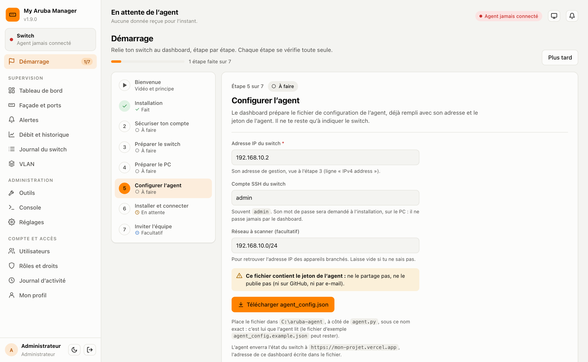

Le fichier est **déjà rempli** : adresse du dashboard, jeton de l’agent, IP du switch. Le mot de passe SSH du switch
n’y figure jamais : il est demandé à l’étape suivante et chiffré par Windows.

> **Attention** : `agent_config.json` contient le **jeton de l’agent**. Ne le partage pas, ne l’envoie pas par e-mail,
> **ne le publie jamais** (GitHub, forum, capture d’écran). Si c’est arrivé : change `AGENT_TOKEN` dans Vercel,
> redéploie, puis télécharge un nouveau fichier.

- Si le navigateur a renommé le fichier (`agent_config (1).json`), renomme-le en `agent_config.json`.
- Si le dashboard te demande d’abord d’activer la double authentification, fais l’[étape 4](#4-sécuriser-ton-compte).
- Tu préfères la méthode manuelle (copier l’exemple et le compléter) ? Voir
  [`agent/INSTALLATION-WINDOWS.md`](../agent/INSTALLATION-WINDOWS.md).

### 6.5 Installer l’agent comme service

Dans l’assistant, étape **Installer et connecter** :

1. Dans `C:\aruba-agent`, fais un **clic droit** sur `installer-service.bat`.
2. Choisis **Exécuter en tant qu’administrateur**, puis **Oui** dans la fenêtre de Windows.
   Si Windows affiche d’abord un avertissement (« Windows a protégé votre ordinateur », ou « Avertissement de sécurité »),
   clique sur **Informations complémentaires** puis **Exécuter quand même**, ou sur **Exécuter** : le fichier vient
   de la page officielle des versions.

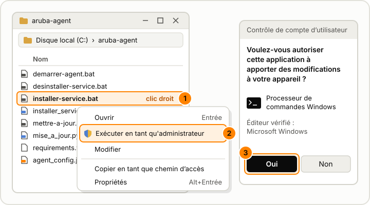

3. Une fenêtre noire demande le **mot de passe SSH du switch** (« Mot de passe SSH de admin@192.168.10.2 : »).
   Tape-le et appuie sur Entrée. Les caractères ne s’affichent pas pendant la saisie : c’est normal.

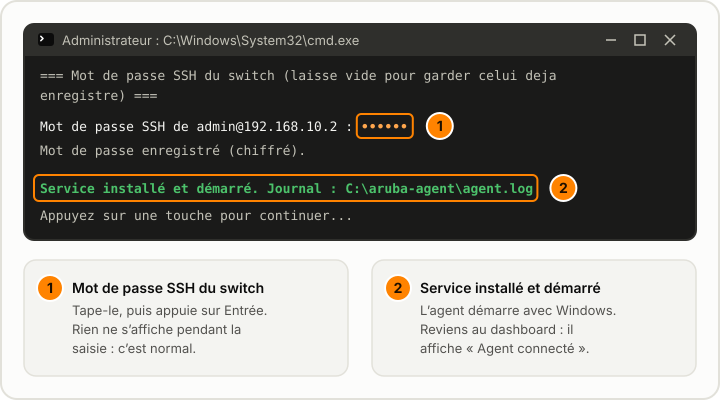

**Tu dois voir** « Mot de passe enregistré (chiffré). » puis « Service installé et démarré ».
Appuie sur une touche pour fermer la fenêtre.

L’agent tourne maintenant en arrière-plan, sans fenêtre. Il démarre avec Windows, même sans session ouverte,
redémarre tout seul en cas d’erreur et se met à jour tout seul à partir des versions publiées.

## 7. Vérifier la connexion

⏱ 1 minute · dans l’assistant : étape « Installer et connecter »

Reviens dans le dashboard. L’assistant affiche **En attente de l’agent…** puis, en moins d’une minute :

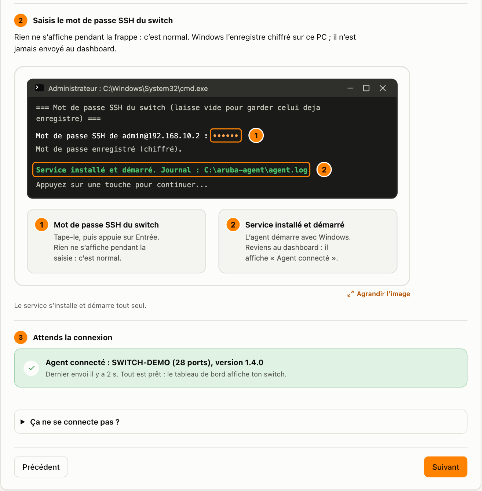

**Tu dois voir** « Agent connecté » avec le nom de ton switch, son nombre de ports et la version de l’agent
(ici « SWITCH-DEMO (28 ports) »). En haut du tableau de bord, la pastille indique **Agent en ligne**.


Si l’agent reste en attente plus de 2 minutes, ouvre le dépannage de l’assistant ou la section
[L’agent ne se connecte pas](#lagent-ne-se-connecte-pas).

## 8. Inviter l’équipe et régler les alertes

⏱ 3 minutes · facultatif · dans l’assistant : étape « Inviter l’équipe »

### Créer des comptes

Un compte par personne : chacun a son mot de passe, et ses actions sont signées dans le journal d’activité.

1. Ouvre **Utilisateurs** (barre latérale, ou bouton **Créer des comptes** de l’assistant).
2. Clique sur **+ Nouvel utilisateur**.
3. Indique le **Nom** et l’**Identifiant ou e-mail**.
4. Choisis le **Rôle** :
   - **Administrateur** : tout, y compris les comptes ;
   - **Technicien** : agit sur les ports d’accès, ni console ni réglages ;
   - **Lecture seule** : regarde sans rien modifier (idéal pour un écran mural).
5. **Mot de passe** : garde **Lien d’invitation** (recommandé, valable 48 h) ou choisis-le maintenant.
6. Clique sur **Créer le compte**, puis envoie le lien à la personne.

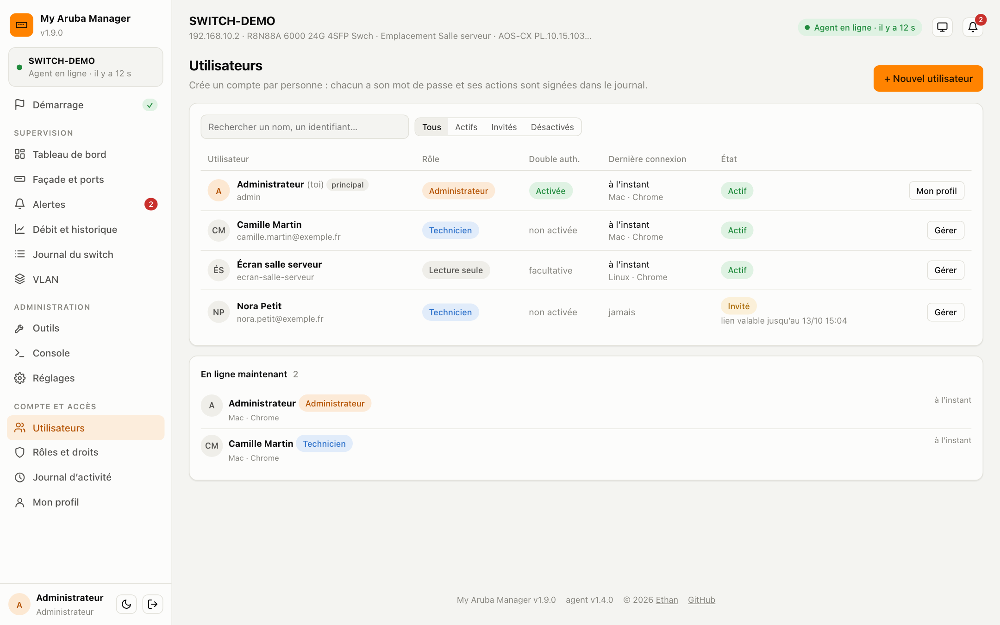

À sa première connexion, chaque personne voit une fenêtre de bienvenue avec la vidéo et ce que son rôle permet :

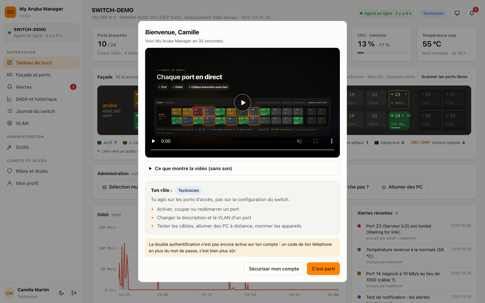

### Recevoir les alertes

1. Ouvre **Réglages** (barre latérale, ou bouton **Régler les alertes** de l’assistant).
2. Remplis **E-mail(s)** et/ou **Webhook** (Teams, Discord, Slack, ntfy pour le téléphone…).
3. Coche les cas à signaler dans **Prévenir quand…** et choisis les **Ports surveillés**.
4. Clique sur **Enregistrer** (la fenêtre se ferme).
5. Rouvre **Réglages** et clique sur **Envoyer un test** : tu dois recevoir le message de test.
   Le test utilise les réglages enregistrés : enregistre toujours avant de tester.


Les alertes par **e-mail** passent par **Resend** : ajoute Resend depuis le Marketplace Vercel, puis redéploie.
Sans domaine vérifié, Resend n’écrit qu’à l’adresse de ton propre compte Resend (expéditeur par défaut
`onboarding@resend.dev`). Pour écrire à d’autres adresses, vérifie ton domaine dans Resend, puis mets la variable
`ALERT_FROM` sur ce domaine (par exemple `Switch <alertes@mon-domaine.fr>`).
Autre variable facultative : `DASHBOARD_URL` (lien inclus dans les alertes). Les webhooks ne demandent aucun service en plus.

### Terminer

Dans l’assistant, clique sur **Terminer**. **Tu dois voir** le tableau de bord, et l’entrée **Démarrage** marquée ✓.

---

## Dépannage

### Une variable manque ou est fausse

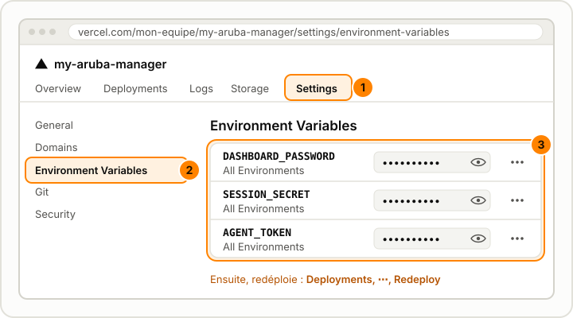

1. Dans ton projet Vercel : **Settings**, puis **Environment Variables**.
2. Ajoute ou corrige `DASHBOARD_PASSWORD`, `SESSION_SECRET` ou `AGENT_TOKEN` (garde **All Environments**, ou au moins **Production**).
3. Redéploie (**Deployments**, **⋯**, **Redeploy**), puis clique sur **Revérifier** dans le dashboard.

> **Attention** : garde `SESSION_SECRET` tel quel une fois l’installation faite : le changer déconnecte tout le monde.
> Si tu changes `AGENT_TOKEN`, l’agent ne peut plus se connecter : télécharge un nouveau `agent_config.json`
> (étape 6.4), place-le dans `C:\aruba-agent`, puis [redémarre l’agent](#redémarrer-lagent).

### Je ne peux pas me connecter

- L’identifiant du premier compte est `admin`. Le mot de passe est `DASHBOARD_PASSWORD`, exactement comme dans Vercel.
- Tu as modifié `DASHBOARD_PASSWORD` dans Vercel ? Redéploie pour qu’il soit pris en compte.
- Après 8 essais ratés, la connexion est bloquée 15 minutes (« Trop de tentatives »). Attends, puis réessaie.
- Mot de passe oublié : un administrateur t’envoie un lien depuis **Utilisateurs**. Pour le compte `admin`,
  `DASHBOARD_PASSWORD` fonctionne toujours en secours.
- Téléphone perdu (double authentification) : utilise un code de secours, ou suis la section
  « Téléphone perdu » du [README](../README.fr.md#téléphone-perdu-double-authentification).

### La vérification automatique est en échec

Active `pg_cron` et `pg_net` dans Supabase : voir [Si la vérification automatique est en échec](#si-la-vérification-automatique-est-en-échec).

### L’agent ne se connecte pas

Vérifie dans cet ordre :

1. **Le PC est allumé et pas en veille**, et il a accès à internet.
2. **Le service tourne** : ouvre une Invite de commandes **en administrateur** (menu Démarrer, tape `cmd`,
   clic droit sur **Invite de commandes**, **Exécuter en tant qu’administrateur**), puis tape :

   ```bat
   cd /d C:\aruba-agent
   python installer_service.py status
   ```

   Pour le relancer, [redémarre l’agent](#redémarrer-lagent).
3. **Lis le journal** `C:\aruba-agent\agent.log` (ouvre-le avec le Bloc-notes), en partant de la fin :

| Message dans agent.log | Cause | Solution |
|---|---|---|
| « Mot de passe SSH refusé par le switch » | mauvais mot de passe SSH | relance `installer-service.bat` en administrateur et retape le mot de passe |
| « Switch injoignable » ou « Liaison switch perdue » | IP fausse, SSH inactif ou bloqué | vérifie l’IP et SSH ([étape 5](#5-préparer-le-switch)), et teste `ssh admin@IP` depuis ce PC |
| « Dashboard : HTTP 401 » | jeton de l’agent différent de `AGENT_TOKEN` | télécharge un nouveau `agent_config.json` (étape 6.4), puis [redémarre l’agent](#redémarrer-lagent) |
| « Dashboard injoignable » | pas d’internet, pare-feu, proxy ou mauvaise adresse | vérifie `dashboard_url` dans `agent_config.json` et que le PC ouvre l’adresse du dashboard dans un navigateur |

- `installer-service.bat` affiche une erreur `agent_config.json` introuvable (FileNotFoundError) : le fichier manque
  dans `C:\aruba-agent` ou porte un autre nom (Windows masque parfois l’extension : `agent_config.json.txt`).
- « python » n’est pas reconnu, « Python est introuvable », ou le **Microsoft Store** s’ouvre quand tu tapes `python` :
  Python n’est pas dans le PATH (case oubliée, ou Python installé avec un autre compte Windows que celui qui lance
  `installer-service.bat`). Réinstalle-le en cochant **Add python.exe to PATH** : voir [l’étape 6.1](#61-installer-python-3).
- Un pare-feu d’entreprise doit laisser sortir le PC en **HTTPS** (port 443) vers ton adresse `vercel.app` et vers
  `api.github.com` (mise à jour automatique de l’agent), et le laisser joindre le switch en **SSH** (port 22).
  Aucun port n’est à ouvrir en entrée.

### Redémarrer l’agent

Après un changement de `agent_config.json` (nouveau jeton, réseau à scanner…), l’agent doit redémarrer pour le lire.
Le plus simple : dans `C:\aruba-agent`, clic droit sur `installer-service.bat`, **Exécuter en tant qu’administrateur**,
puis appuie sur **Entrée sans rien taper** quand le mot de passe SSH est demandé (« Rien de changé. » : le mot de passe
enregistré est gardé). Le service est arrêté puis relancé, et la fenêtre affiche « Service installé et démarré ».

### Les appareils n’ont pas d’adresse IP

Indique le **Réseau à scanner (facultatif)** (par exemple `192.168.10.0/24`) à l’étape 6.4, télécharge le nouveau fichier,
remplace l’ancien et [redémarre l’agent](#redémarrer-lagent). L’agent relève les IP toutes les 5 minutes.

### Le dashboard ne répond plus après une semaine sans agent

L’offre gratuite de Supabase met le projet en pause après 7 jours sans activité. L’agent écrit en continu :
cela n’arrive que si le PC reste éteint une semaine. Ouvre ton projet sur supabase.com et relance-le
(**Restore project**).

---

## Mettre à jour

### L’agent

Rien à faire : il se met à jour tout seul, uniquement à partir des versions publiées sur la page
[Releases](https://github.com/ethanfrq/ArubaDashboardSwitch/releases). Le bas du dashboard affiche
« mise à jour auto ✓ ». Détails : [`agent/INSTALLATION-WINDOWS.md`](../agent/INSTALLATION-WINDOWS.md#mise-à-jour-automatique).

### Le dashboard

Le bouton Deploy a créé **ta propre copie** du projet sur GitHub : elle ne suit pas les nouvelles versions toute seule.
Avant chaque mise à jour, lis le [`CHANGELOG.md`](../CHANGELOG.md) (section « Passer de la … à la … »).

**Le plus simple (une seule fois) : passer sur un fork.**

1. Sur [la page du projet](https://github.com/ethanfrq/ArubaDashboardSwitch), clique sur **Fork** pour créer ton fork.
2. Dans ton projet Vercel : **Settings**, **Git**, déconnecte le dépôt actuel puis connecte ton fork.
   Les variables et la base Supabase restent attachées au projet Vercel : rien n’est perdu.
3. Ensuite, pour chaque nouvelle version : sur ton fork, **Sync fork** puis **Update branch**.
   Vercel redéploie tout seul.

**Avec Git** (si tu es à l’aise avec la ligne de commande). Remplace `TON-COMPTE/TON-DEPOT` par ta copie :

```sh
git clone https://github.com/TON-COMPTE/TON-DEPOT.git
cd TON-DEPOT
git pull --no-rebase -X theirs --allow-unrelated-histories https://github.com/ethanfrq/ArubaDashboardSwitch.git main
git push
```

Vercel redéploie tout seul après le `git push`.

---

*Guide de [My Aruba Manager](../README.fr.md). Une erreur, une étape pas claire ?
Ouvre une [issue](https://github.com/ethanfrq/ArubaDashboardSwitch/issues) (sans IP, mots de passe ni jetons).*
